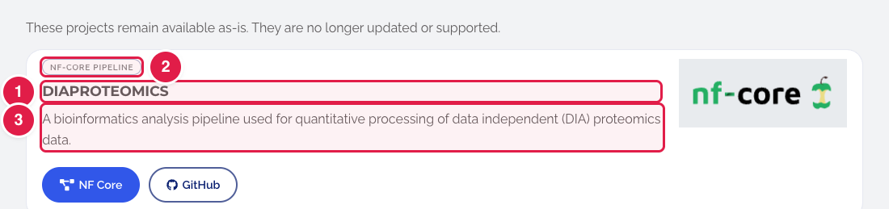
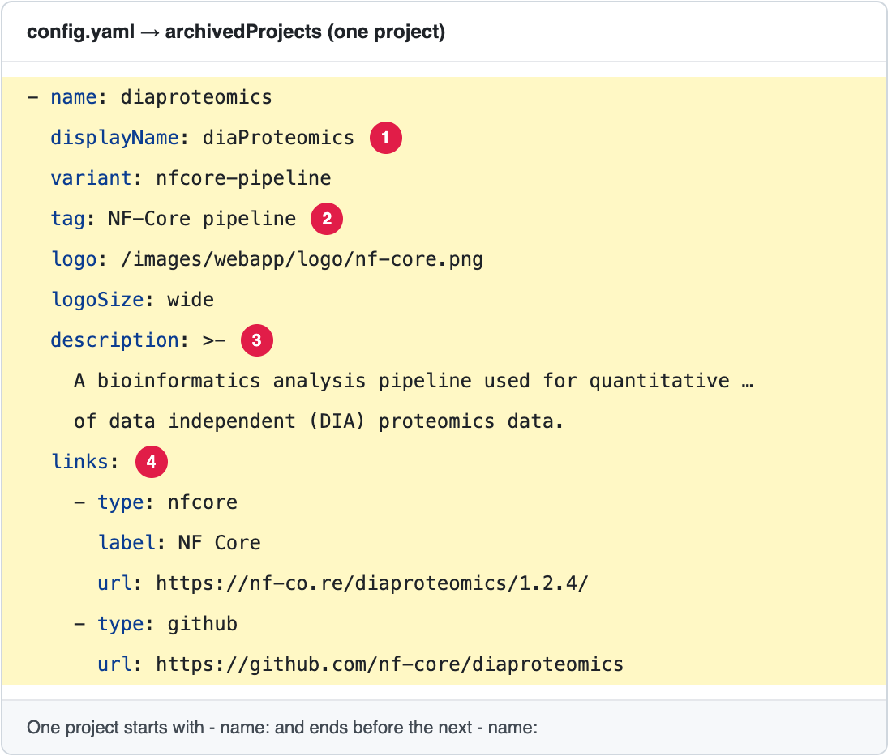

# Add, change or remove an Archived App

**Archived Apps** are old projects that still work but are no longer updated. They appear on **https://openms.de/archived-apps/**.

**You will change:** one block in `config.yaml`  ·  **Time:** about 15 minutes  ·  **Skills needed:** none

**On the website**



**In `config.yaml`**



The numbers match: the part marked **1** on the website is the line marked **1** in the file.

## What you will change

| Part of the page | Search for | Lines |
|------------------|-----------|-------|
| The list of projects | `archivedProjects:` | One block per project (see below). |
| "Good to know" box | `archivedSection:` | `notice:` → `title`, `lead`, and the `points` (each has `title` and `text`). |
| "Interested in reviving one of these projects?" | `archivedSection:` | `revivalPrompt`, `revivalNote`, and the two buttons `contactText` / `contactUrl`, `sponsorText` / `sponsorUrl`. |
| Big title, short text and the buttons at the top | — | These are in the page file `content/en/archived-apps.md`. See [Change the text of a page](../any-page/edit-page-text.md). |

One project looks like this:

```yaml
        - name: diaproteomics
          displayName: diaProteomics
          variant: nfcore-pipeline
          tag: NF-Core pipeline
          logo: /images/webapp/logo/nf-core.png
          logoSize: wide
          description: >-
            A bioinformatics analysis pipeline used for quantitative processing
            of data independent (DIA) proteomics data.
          links:
            - type: github
              url: https://github.com/nf-core/diaproteomics
```

| Line | What it is |
|------|-----------|
| `displayName:` | The name people see. |
| `tag:` | The small label on the card. |
| `logo:` | The logo picture. Upload it first: see [Add images](../any-page/add-images.md). |
| `description:` | The text on the card. Keep its lines indented. |
| `links:` | The buttons on the card. Each has a `type` and a `url`. |

Leave `name:`, `variant:` and `logoSize:` as they are in the block you copy.

## Step by step

1. Open **https://github.com/OpenMS/OpenMS-website/blob/main/config.yaml** and click the **pencil icon**. ([Need help?](../../getting-started/edit-via-github.md#step-1--open-the-file))
2. Click inside the text box, press **Ctrl + F** (Windows) or **Cmd + F** (Mac) and search for `archivedProjects:`.
3. **Add a project:** copy a whole block (from `- name:` to the line before the next `- name:`), paste it at the end of the list and change the words. **Remove a project:** delete its whole block. **Change a project:** change the words after the colon.
4. Save and send for review: [How to make a change, steps 3 to 6](../../getting-started/edit-via-github.md#step-3--save-commit-changes).
5. Open the **Deploy Preview** and check **/archived-apps/**.

## How many buttons (links) can a project have?

There is **no fixed limit**: every `- type:` line under `links:` becomes one button. Archived cards are wide, so **many buttons fit on one line** (more than 5 on a large screen). Keep it to **2 or 3** so the card stays easy to read. Today the archived project has 2 buttons.

- Extra buttons go onto a **new line**. That works, but the card becomes taller than the others next to it.
- On a **phone**, the buttons often go under each other. That is normal.
- The buttons are shown **in the order you write them**, except **GitHub**, which is always last.

| `type:` | Button text | Look |
|---------|-------------|------|
| `demo` | Demo | filled blue, play icon |
| `homepage` | Homepage | filled blue, house icon |
| `pypi` | PyPI | filled blue, Python icon |
| `install` | Install | outlined, Windows icon |
| `github` | GitHub | outlined, GitHub icon. **Always shown last.** |
| `nfcore` | NF Core | outlined |
| anything else | Link | outlined |

To change the button text, add a line `label:` (for example `label: Install (Windows)`).


## Moving an app to the archive

To move an app from **Featured** or **Affiliated** to **Archived**, remove its block there (see [Featured Apps](../featured-apps/update-featured-apps.md) or [Affiliated Apps](../affiliated-apps/update-affiliated-apps.md)) and add a new block here.

## Related guides

- [Affiliated Apps](../affiliated-apps/update-affiliated-apps.md)
- Back to the [list of all tasks](../README.md)
