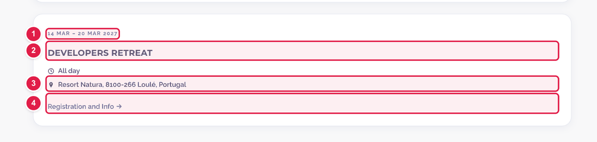

# Add or change an event on the Community calendar

The **Community events** page (**https://openms.de/calendar/**) lists upcoming and past meetings, workshops and outreach events. The **Upcoming events** on the home page come from the same list.

**The only way to add, change or remove an event is the OpenMS Google Calendar.** Whenever the calendar changes, a robot copies it to the website, usually within a few minutes. Do **not** edit `data/community_events.yaml` on GitHub: the robot rewrites that file and your change would be lost.

**You need:** access to the OpenMS Google Calendar (ask the web team: [Who to ask](../../workflow/who-to-ask.md))  ·  **Time:** about 5 minutes  ·  **Skills needed:** none

## What an event looks like



| Number | What it shows | Google Calendar field |
|:--:|---------------|-----------------------|
| 1 | The date (or date range) | The event's date, or first and last day |
| 2 | The event name | Event title |
| 3 | The place | Location |
| 4 | A link (for example to sign up) | A line in the description such as `Registration: https://…` |

## Add an event

1. Open the **OpenMS Google Calendar** and create the event.
2. Fill in the fields (see the table below).
3. Save it. **Wait a few minutes**: the robot copies it to the website, and the site is rebuilt.
4. Open **https://openms.de/calendar/** and check the event. If it is not there after 30 minutes, ask the web team.

| Google Calendar field | On the website | Tips |
|-----------------------|----------------|------|
| **Event title** | The card heading | Copied exactly, so check the spelling. Titles containing *workshop*, *developer meeting* (or *dev meeting*), *outreach*, *code clinic*, *open house* or *summer of code* get a matching coloured tag. |
| **Date** | The date | For an event of several days, tick **All day** and choose the first and the last day. A timed event also shows its time and time zone. |
| **Location** | The place | Plain text, for example `Helsinki, Finland` or `Online`. |
| **Description** | The short text under the title | Keep it short: it is cut after **160 characters**. To add a link, write it on **its own line** as `Label: https://…`, for example `Registration: https://example.org/register` or `News: https://openms.de/news/my-article/`. The label (one or two words, letters only) becomes the link text. |

## Change or remove an event

- **Change:** edit the event in the Google Calendar. The website follows within a few minutes.
- **Remove:** delete the event in the Google Calendar. It disappears from the website at the next copy.
- **Past events** stay on the website, under **Past events**, for 5 years after they ended.

## Common mistakes

| What went wrong | How to fix it |
|-----------------|---------------|
| My event does not appear | Wait a few minutes, then reload the page. Check that you added it to the **OpenMS** calendar, not your own. |
| My change in `community_events.yaml` was undone | That file is written by the robot. Make the change in the Google Calendar. |
| The link is not clickable | Put it on its own line in the description, as `Label: https://…`, with the full address starting with `https://`. |
| A multi-day event shows one day too many or too few | Use **All day** and choose the real last day as the end. |
| The text is cut off | The description is cut after 160 characters. Shorten it. Links on their own line are kept. |

## For the web team (advanced)

These parts are not needed for normal event updates.

### How the copy works

Three pieces work together:

1. **`calendar-notify-github`**, a Google Apps Script on the **openmsuser** Google account (the account that also holds the calendar). When an event is created, changed or deleted, it tells GitHub (a `calendar-updated` event).
2. **`.github/workflows/update_calendar.yml`**, the GitHub workflow "Sync Google Calendar". It starts on that signal. It can also be started by hand: **Actions → Sync Google Calendar → Run workflow**.
3. **`sync_google_calendar.py`**, which reads the calendar and writes its events into `data/community_events.yaml` (each marked `synced: true`). The workflow commits the file straight to `main` with the OpenMS GitHub App, and Netlify rebuilds the site. If nothing changed, nothing is committed.

### Turn on the Google Calendar connection

1. In Google Calendar, open **Settings → the calendar → Integrate calendar** and copy **Secret address in iCal format**.
2. Add it on GitHub as the repository secret `GOOGLE_CALENDAR_ICS_URL` (**Settings → Secrets and variables → Actions**).
3. **Treat that address like a password.** It gives read access to the whole calendar. Never paste it into a file, an issue or a pull request.
4. Optional: in `config.yaml` under `calendarSection`, fill in `googleCalendarSubscribeUrl` to show an "Add to Google Calendar" button. The comment above that key explains the format. This public link is different from the secret above.

If the secret is missing, the robot does nothing and the website keeps the last copied events.

### If the Apps Script needs to be set up again

`calendar-notify-github` sends GitHub a `calendar-updated` event. It needs a GitHub token with **Contents: Read and write** on this repository, stored in the script's **Project Settings → Script properties** as `GH_TOKEN`. Its code looks like this; run `setup` once after pasting it:

```js
const REPO = 'OpenMS/OpenMS-website';
const CALENDAR_ID = 'CALENDAR_ID_OR_EMAIL';   // the calendar that feeds the site

function notifyGitHub() {
  UrlFetchApp.fetch('https://api.github.com/repos/' + REPO + '/dispatches', {
    method: 'post',
    contentType: 'application/json',
    headers: {
      Authorization: 'Bearer ' + PropertiesService.getScriptProperties().getProperty('GH_TOKEN'),
      Accept: 'application/vnd.github+json',
    },
    payload: JSON.stringify({ event_type: 'calendar-updated' }),
  });
}

function setup() {
  ScriptApp.newTrigger('notifyGitHub').forUserCalendar(CALENDAR_ID).onEventUpdated().create();
}
```

Never put the token in this repository.

### Where the page's text and layout live

- Headings and section text: `config.yaml` → `calendarSection`
- Layout: `layouts/partials/community-calendar-main.html`
- Styling: `assets/css/community-calendar.css`, `assets/css/calendar-gcal-sync.css`

## Related guides

- [Edit the news and events blocks on the home page](../home-page/edit-news-and-events-blocks.md)
- [Add a news article](../news/add-news-post.md), then link it from the event's description with `News: https://openms.de/news/…`
- Back to the [list of all tasks](../README.md)
