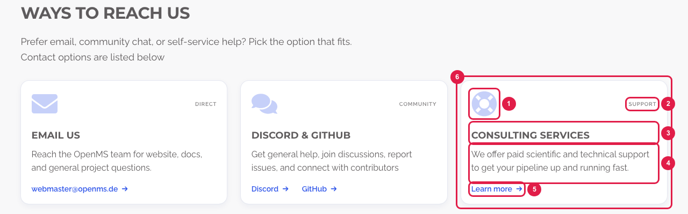
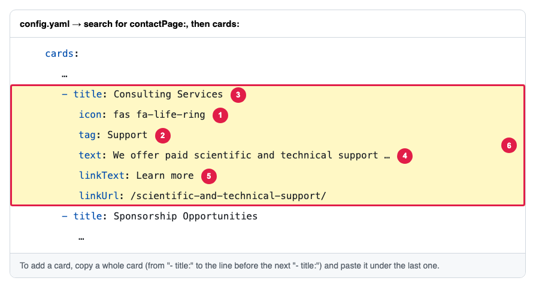

# Add or change the cards on the Contact page

The page **https://openms.de/contact/** (top menu → **About** → **Contact**) lists the ways to reach OpenMS as cards under **Ways to reach us**. Each card is a small block in `config.yaml`, under `contactPage` → `cards`. You can change the words, add a card or remove one.

**You will change:** a few lines in `config.yaml`  ·  **Time:** about 10 minutes  ·  **Skills needed:** none

**On the website**



**In `config.yaml`**



The numbers match: the part marked **1** on the website is the line marked **1** in the file.

| Number | What it is | Line |
|:--:|------------|------|
| 1 | The icon | `icon:` |
| 2 | The small word in the corner | `tag:` |
| 3 | The card title | `title:` |
| 4 | The text | `text:` |
| 5 | The link at the bottom | `linkText:` (the words) and `linkUrl:` (the address). The whole card is clickable. |
| 6 | One whole card | from `- title:` down to the line before the next `- title:` |

## Cards with several links

The **Discord & GitHub** card has two separate links. Instead of `linkText` and `linkUrl`, it has a `links` list, one `- text:` and `url:` pair per link:

```yaml
            links:
              - text: Discord
                url: https://discord.com/invite/v9tv5BxPch
              - text: GitHub
                url: https://github.com/OpenMS/OpenMS/issues
```

## Step by step

1. Open **https://github.com/OpenMS/OpenMS-website/blob/main/config.yaml** and click the **pencil icon**. ([Need help?](../../getting-started/edit-via-github.md#step-1--open-the-file))
2. Press **Ctrl + F** (Windows) or **Cmd + F** (Mac) and search for `contactPage:`. The `cards:` list is just below the intro.
3. **To change a card**, change only the words after the colon. If a text contains a colon (`:`), keep it inside quotes.
4. **To add a card**, copy a whole card (from its `- title:` line down to the line before the next `- title:`), paste it where you want it in the list and change the words. Keep the spaces at the start of each line exactly as in the card you copied. See [Spaces matter](../../getting-started/edit-via-github.md#spaces-matter-in-configyaml).
5. **To remove a card**, delete all its lines.
6. Save and send for review: [How to make a change, steps 3 to 6](../../getting-started/edit-via-github.md#step-3--save-commit-changes).
7. Open the **Deploy Preview** and check **/contact/** on a laptop and on a phone.

## Icons

An icon is a Font Awesome name, for example `fas fa-envelope` or `fab fa-github`. Search for one on **https://fontawesome.com/v5/search?m=free** (version 5, free icons) and copy its name, starting with `fas`, `far` or `fab`.

## Good to know

- Any number of cards works: 3 per row on a laptop, 1 per row on tablets and phones. Cards in the same row get the same height, and the links stay at the bottom.
- The cards show in the order of the list.
- Addresses starting with `http` open in a new tab. Addresses on this site (like `/press-kit/`) and e-mail links (`mailto:…`) open in the same tab.
- A card without `linkText` and `linkUrl` (and without `links`) has no link.

## Related guides

- [Change the intro text of the Contact page](edit-intro-text.md)
- [Which files are behind this page](../../reference/file-locations.md#everything-in-the-navbar-and-the-footer-where-is-each-page)
- Back to the [list of all tasks](../README.md)
