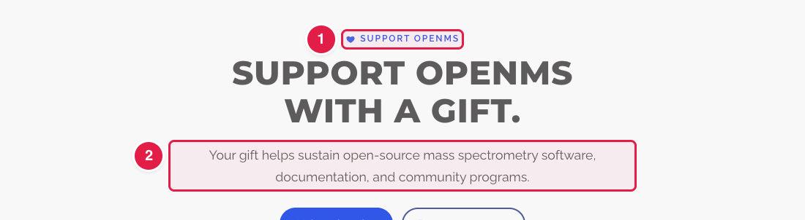
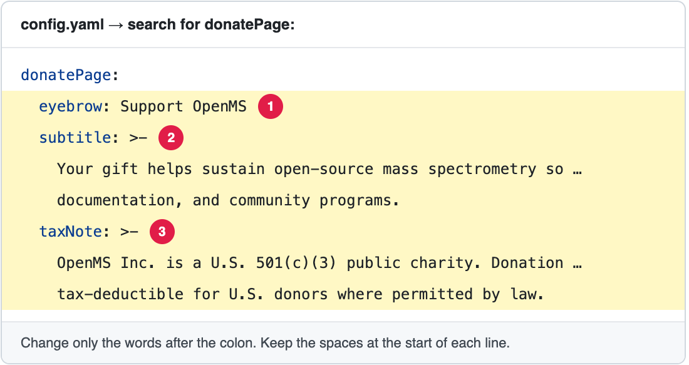

# Change the intro text of the Donate page

The page **https://openms.de/donate/** (footer → **SUPPORT** → **Donate**) starts with a small word above the title and an intro sentence. These are in `config.yaml`.

**You will change:** one or two lines in `config.yaml`  ·  **Time:** about 5 minutes  ·  **Skills needed:** none

**On the website**

**In `config.yaml`**

The numbers match: the part marked **1** on the website is the line marked **1** in the file.

## What you will change

| Part of the page | Line in `donatePage` |
|---|---|
| The small word above the title | `eyebrow` |
| The intro sentence | `subtitle` |
| The tax note | `taxNote` |

The other words (the big title and "Where your gift goes" with its three boxes) are part of the design (`layouts/partials/donate-main.html`). To change them, ask the web team ([Who to ask](../../workflow/who-to-ask.md)).

For the donation form itself, see [Connect the Donate page to Zeffy](connect-zeffy.md).

## Step by step

1. Open **https://github.com/OpenMS/OpenMS-website/blob/main/config.yaml** and click the **pencil icon**. ([Need help?](../../getting-started/edit-via-github.md#step-1--open-the-file))
2. Click inside the text box, press **Ctrl + F** (Windows) or **Cmd + F** (Mac) and search for `donatePage:`.
3. Change **only the words after the colon**. Keep the quotes and the spaces at the start of each line. See [Spaces matter](../../getting-started/edit-via-github.md#spaces-matter-in-configyaml).
4. Save and send for review: [How to make a change, steps 3 to 6](../../getting-started/edit-via-github.md#step-3--save-commit-changes).
5. Open the **Deploy Preview** and check **/donate/**.

## Related guides

- [Which files are behind this page](../../reference/file-locations.md#everything-in-the-navbar-and-the-footer-where-is-each-page)
- Back to the [list of all tasks](../README.md)
