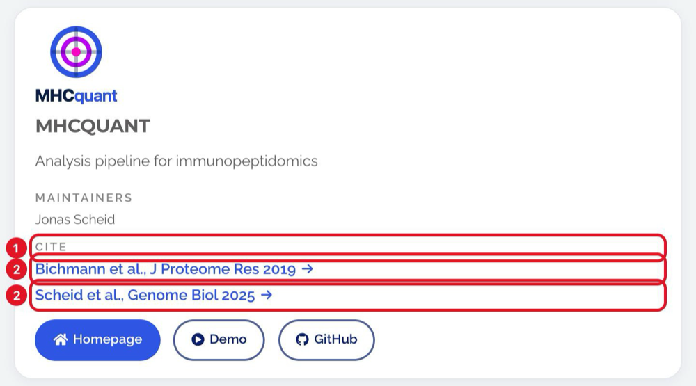
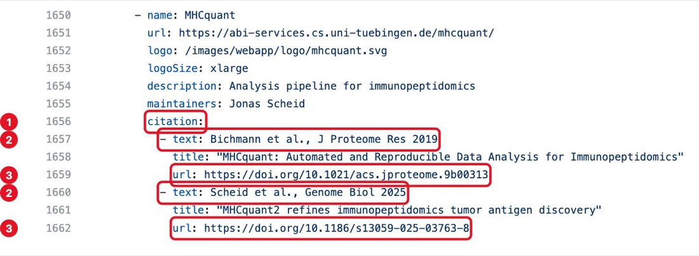

# Featured Apps page: Add, change or remove the papers to cite

On **https://openms.de/featured-apps/**, an app card can show a **Cite** line: the paper (or papers) people should cite when they use the app. Each paper is a link that opens the paper. A card can list **one paper or several**, one per line. The same works on **https://openms.de/affiliated-apps/**.

**You will change:** a few lines in `config.yaml`  ·  **Time:** about 10 minutes  ·  **Skills needed:** none  ·  **You need:** the paper's DOI (for example `10.1021/acs.jproteome.9b00313`)

## What you will change

**On the website** (the MHCquant card, which cites two papers)



**In `config.yaml`**



The numbers match: the part marked **1** on the website is the line marked **1** in the file. Number **3**, the address, is not visible on the page: it is where the link goes when someone clicks a paper.

| Number | Line | What it is |
|:--:|------|-----------|
| 1 | `citation:` | Starts the list of papers for this app. It sits inside the app's block, at the same indentation as `maintainers:`. On the website it becomes the small **Cite** label. |
| 2 | `- text:` | What people see for one paper, usually *First author* et al., *Journal* *Year*, for example `Bichmann et al., J Proteome Res 2019`. Each paper starts with `- ` (a dash and a space). |
| 3 | `url:` | Where the link goes. Use the paper's DOI address: `https://doi.org/` followed by the DOI. It keeps working even if the publisher moves the article. |
| – | `title:` | **Optional.** The paper's full title, shown when the mouse is on the link. Put it in quotes (`"…"`) because titles often contain a colon. |

> Each paper is **one block of two or three lines** starting with `- text:`. The lines of one paper start with the same number of spaces.

## Step by step

### Step 1 – Find the paper's details

1. Find the paper's **DOI**. It is on the paper's web page and in its address, and looks like `10.1186/s13059-025-03763-8`.
2. To check the authors, journal and year, open `https://doi.org/` followed by the DOI in your browser: it opens the paper.
3. Write the short text people will see: *First author's last name* et al., *journal (short name)* *year*. For example `Scheid et al., Genome Biol 2025`.

### Step 2 – Open `config.yaml` and find the app

1. Open **https://github.com/OpenMS/OpenMS-website/blob/main/config.yaml** and click the **pencil icon**. ([Need help?](../../getting-started/edit-via-github.md#step-1--open-the-file))
2. Click inside the text box, press **Ctrl + F** (Windows) or **Cmd + F** (Mac) and search for the app's name, for example `name: MHCquant`. Featured Apps are in the `webapps:` list; Affiliated Apps are in the `affiliateProjects:` list.

### Step 3 – Add, change or remove a paper

**To add the first paper** to an app that has none, add these lines right under its `maintainers:` line (or under `description:` if there is no `maintainers:`), with the same spaces at the start:

```yaml
          citation:
            - text: Bichmann et al., J Proteome Res 2019
              title: "MHCquant: Automated and Reproducible Data Analysis for Immunopeptidomics"
              url: https://doi.org/10.1021/acs.jproteome.9b00313
```

**To add a second paper**, copy one whole paper block (from its `- text:` line to its `url:` line), paste it right under, and change the words:

```yaml
          citation:
            - text: Bichmann et al., J Proteome Res 2019
              title: "MHCquant: Automated and Reproducible Data Analysis for Immunopeptidomics"
              url: https://doi.org/10.1021/acs.jproteome.9b00313
            - text: Scheid et al., Genome Biol 2025
              title: "MHCquant2 refines immunopeptidomics tumor antigen discovery"
              url: https://doi.org/10.1186/s13059-025-03763-8
```

The papers show in this order, one per line, under one **Cite** label.

**To change a paper**, change only the words after `text:`, `title:` or `url:`.

**To remove a paper**, delete its whole block (its `- text:`, `title:` and `url:` lines). **To remove all of them**, also delete the `citation:` line.

> Some apps are written in the older one-paper form, without the dash: `citation:` then `text:`, `title:`, `url:` directly under it. That works too. To add a second paper to such an app, put a `- ` in front of its `text:` line, add two spaces in front of its `title:` and `url:` lines, and then add the second block as above.

### Step 4 – Save and check

1. Save and send for review: [How to make a change, steps 3 to 6](../../getting-started/edit-via-github.md#step-3--save-commit-changes). See also [Spaces matter](../../getting-started/edit-via-github.md#spaces-matter-in-configyaml).
2. Open the **Deploy Preview**, add **/featured-apps/** to the address, and check:

- [ ] The app's card shows **Cite** with each paper on its own line, above the buttons.
- [ ] Each link opens the right paper.

## If something goes wrong

| What you see | What to do |
|--------------|------------|
| The preview says **Failed** | The spaces are wrong. The lines of one paper must start with the same number of spaces, and `citation:` with the same number as `maintainers:`. See [Spaces matter](../../getting-started/edit-via-github.md#spaces-matter-in-configyaml). |
| A paper is missing from the card | Each paper needs both `text:` and `url:`. A paper without one of them is not shown. |
| The link opens the wrong page | Check that `url:` is `https://doi.org/` followed by the DOI, with no spaces. |

## Related guides

- [Add, change or remove an app](featured-apps-update-featured-apps.md)
- [Affiliated Apps: Add, change or remove an app](../affiliated-apps-page/affiliated-apps-update-affiliated-apps.md)
- Back to the [list of all tasks](../README.md)
