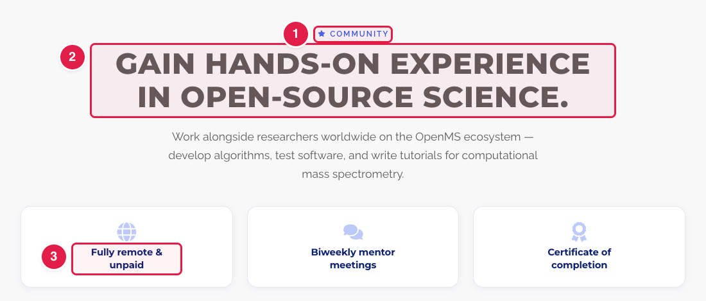
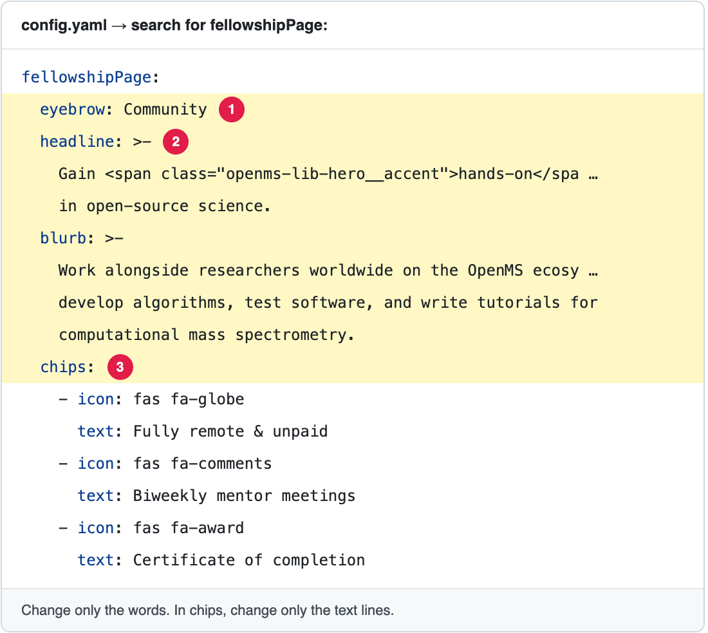

# Update the OpenMS Fellowship page

The page **https://openms.de/fellowship/** presents the fellowship and shows the application form.

**You will change:** a few lines in `config.yaml` (search for `fellowshipPage:`)  ·  **Time:** about 10 minutes  ·  **Skills needed:** none

**On the website**

**In `config.yaml`**

The numbers match: the part marked **1** on the website is the line marked **1** in the file.

## What you will change

| Part of the page | Lines in `fellowshipPage` |
|------------------|----------------------------|
| The small word above the title | `eyebrow` |
| The headline and the text under it | `headline`, `blurb` |
| The three small labels ("Fully remote & unpaid"…) | `chips`: each has `icon` and `text`. Change only `text`. |
| The application form | `tallyFormId`. Ask the web team before changing it ([Who to ask](../../workflow/who-to-ask.md)). |

> `fellowshipPage` also has the lines `projectsTitle`, `projectsLead` and `projects`. **The page does not show them at the moment**, so changing them has no effect. Ask the web team if you want a projects list on the page.

## Step by step

1. Open **https://github.com/OpenMS/OpenMS-website/blob/main/config.yaml** and click the **pencil icon**. ([Need help?](../../getting-started/edit-via-github.md#step-1--open-the-file))
2. Click inside the text box, press **Ctrl + F** (Windows) or **Cmd + F** (Mac) and search for `fellowshipPage:`.
3. Change **only the words after the colon**. Keep the quotes and the spaces at the start of each line. See [Spaces matter](../../getting-started/edit-via-github.md#spaces-matter-in-configyaml).
4. Save and send for review: [How to make a change, steps 3 to 6](../../getting-started/edit-via-github.md#step-3--save-commit-changes).
5. Open the **Deploy Preview** and check **/fellowship/**.

## Related guides

- [Change the text of a page](../any-page/edit-page-text.md)
- Back to the [list of all tasks](../README.md)
