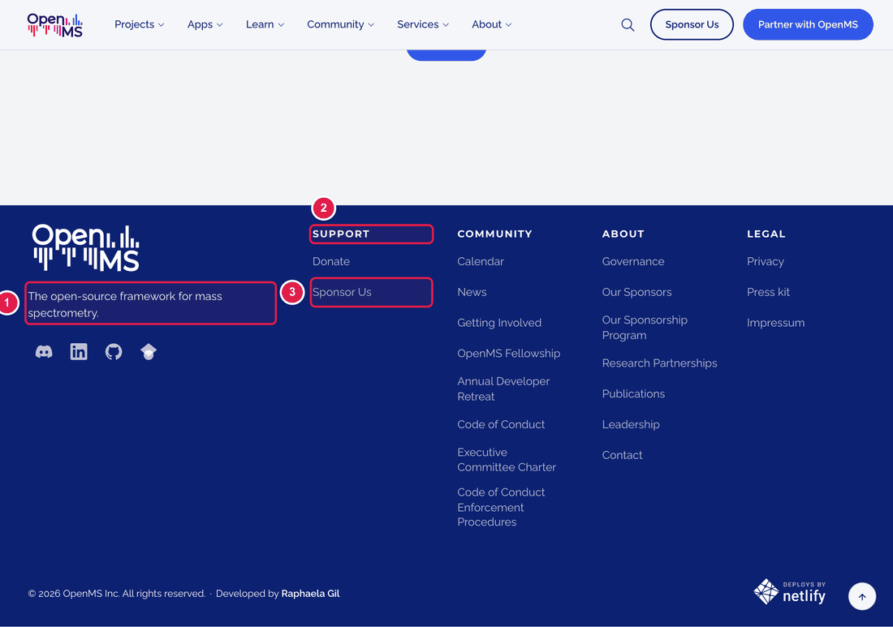
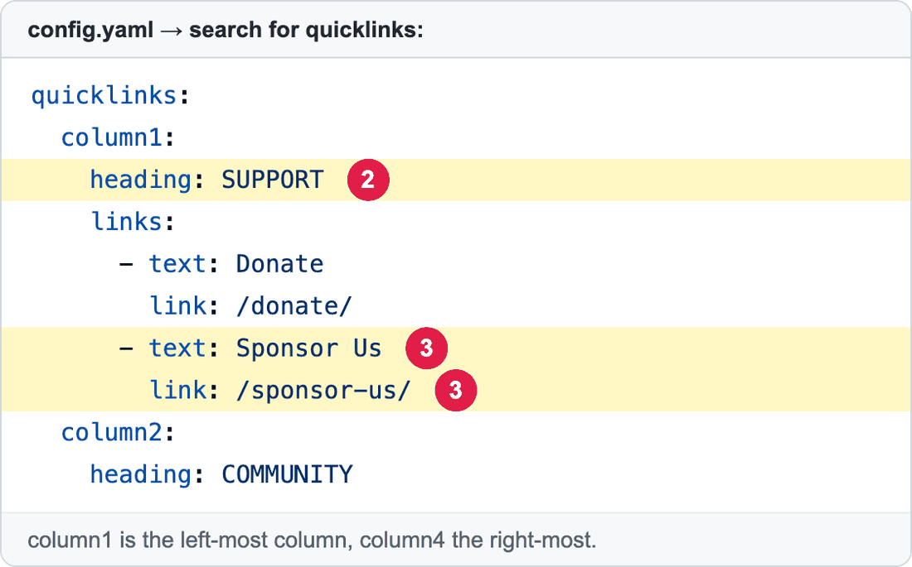

# Change the footer links

The **block at the bottom** of every page, with links in four columns, is called the **footer**. It is written in `config.yaml`. Because it appears everywhere, a change here is seen on the whole website.

**You will change:** a few lines in `config.yaml`  ·  **Time:** about 10 minutes  ·  **Skills needed:** none

1. The **short sentence** under the logo (`tagline:`).
2. The **title of a column** (`heading:`).
3. **One link** in a column.

| Number | Lines | What it is |
|:--:|-------|-----------|
| 2 | `heading:` | The column title. |
| 3 | `text:` and `link:` | One link: the words people read, and the page it opens. |

## Step by step

1. Open **https://github.com/OpenMS/OpenMS-website/blob/main/config.yaml** and click the **pencil icon**. ([Need help?](../../getting-started/edit-via-github.md#step-1--open-the-file))
2. Click inside the text box, press **Ctrl + F** (Windows) or **Cmd + F** (Mac) and search for `quicklinks:`.
3. There are four columns: `column1` (left) to `column4` (right). Find the one you need.
4. Change the words after `text:` or `link:`.
5. To **add a link**, copy two lines (`- text:` and `link:`) inside the column and change them. To **remove** a link, delete its two lines.
6. To change the sentence under the logo, search for `tagline:`.
7. Save and send for review: [How to make a change, steps 3 to 6](../../getting-started/edit-via-github.md#step-3--save-commit-changes).

## Where is the page behind a link?

For every link of the footer, which files hold its page, design, words and styling: see [Everything in the navbar and the footer](../../reference/file-locations.md#everything-in-the-navbar-and-the-footer-where-is-each-page).

## Check the result

Open the **Deploy Preview**. Look at the footer of the **home page** and **one inner page**. Click each link you changed.

## Common mistakes

| What went wrong | How to fix it |
|-----------------|---------------|
| The preview says **Failed** | The spaces at the start of a line are wrong. Compare with the lines above. See [Spaces matter](../../getting-started/edit-via-github.md#spaces-matter-in-configyaml). |
| A link opens "page not found" | Check `link:`. A page of this website starts with `/`, for example `/calendar/`. Another website starts with `https://`. |

## Leave these to the web team

The **logo** picture, the **colours**, the **layout of the columns**, the copyright line, and the "Deployed by Netlify" badge. See [Who to ask](../../workflow/who-to-ask.md).

## Related guides

- [Change the social media icons](edit-social-icons.md)
- [Change the top menu](../navbar/edit-menu-items.md)
- Back to the [list of all tasks](../README.md)
