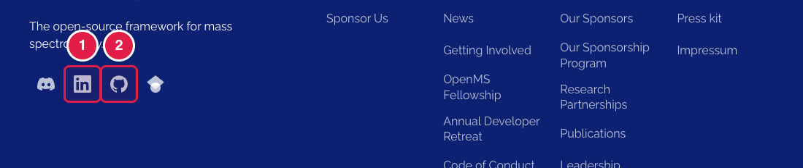
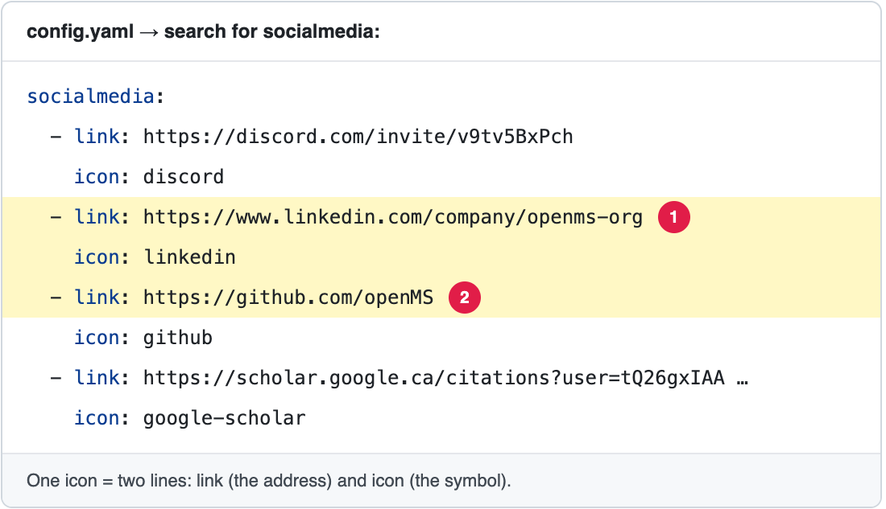

# Change the social media icons

The small icons in the footer (Discord, LinkedIn, GitHub, Google Scholar). The same icons also show in the menu on phones.

**You will change:** two lines in `config.yaml` per icon  ·  **Time:** about 5 minutes  ·  **Skills needed:** none

**On the website**



**In `config.yaml`**



The numbers match: the part marked **1** on the website is the line marked **1** in the file.

## Step by step

1. Open **https://github.com/OpenMS/OpenMS-website/blob/main/config.yaml** and click the **pencil icon**. ([Need help?](../../getting-started/edit-via-github.md#step-1--open-the-file))
2. Click inside the text box, press **Ctrl + F** (Windows) or **Cmd + F** (Mac) and search for `socialmedia:`.
3. Each icon is two lines: `link:` (the address) and `icon:` (which symbol).
   - **Change an address:** change the words after `link:`.
   - **Add an icon:** copy the two lines of an icon, paste them under the last one and change them.
   - **Remove an icon:** delete its two lines.
4. Save and send for review: [How to make a change, steps 3 to 6](../../getting-started/edit-via-github.md#step-3--save-commit-changes).
5. Open the **Deploy Preview** and check the footer.

```yaml
          - link: https://www.linkedin.com/company/openms-org
            icon: linkedin
```

The symbols that exist are `discord`, `linkedin`, `github` and `google-scholar`. For another symbol, ask the web team.

## Related guides

- [Change the footer links](edit-footer-links.md)
- Back to the [list of all tasks](../README.md)
