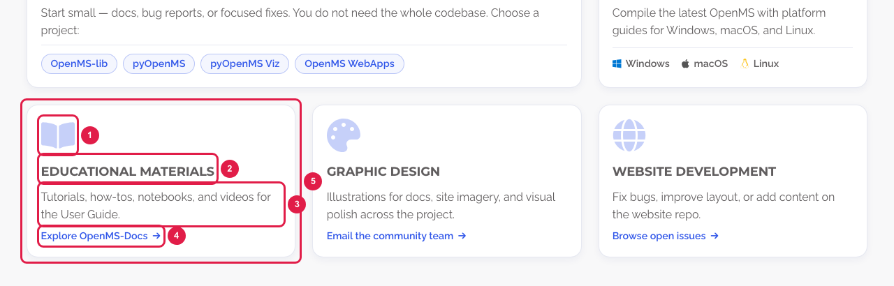
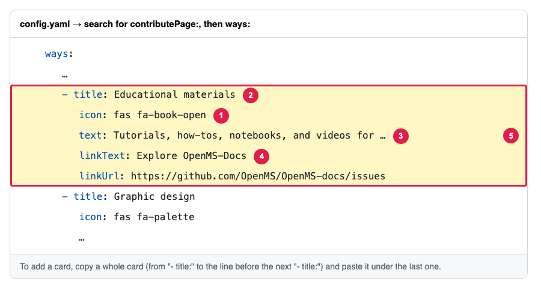

# Add or change the cards on the Getting Involved page

The page **https://openms.de/contribute/** (top menu → **Community** → **Getting Involved**) has three groups of cards and a list of outreach links. Each card is a small block in `config.yaml`, under `contributePage`. You can change the words, add a card or remove one.

**You will change:** a few lines in `config.yaml`  ·  **Time:** about 10 minutes  ·  **Skills needed:** none

**On the website** ("Ways to contribute")

**In `config.yaml`**

The numbers match: the part marked **1** on the website is the line marked **1** in the file.

| Number | What it is | Line |
|:--:|------------|------|
| 1 | The icon | `icon:` |
| 2 | The card title | `title:` |
| 3 | The text | `text:` |
| 4 | The link at the bottom | `linkText:` (the words) and `linkUrl:` (the address) |
| 5 | One whole card | from `- title:` down to the line before the next `- title:` |

## The four lists

| Section on the page | List in `contributePage` | Lines in each card |
|---------------------|--------------------------|--------------------|
| **Ways to contribute** | `ways` | `title`, `icon`, `text`, `linkText` and `linkUrl`. Optional: `badge` (a small label in the top-right corner, like "Most common"), `featured: true` (the card is twice as wide; use it on one card only), `projects` (round link buttons, each with `name` and `url`), `platforms` (a row of small links, each with `name`, `icon` and `url`). |
| **Outreach** (the links in the blue box) | `outreachLinks` | `label`, `hint` (the small line under it), `icon`, `url` |
| **Stay in touch** | `channels` | `title`, `icon`, `text`, `linkText`, `linkUrl` |
| **Code of Conduct → We encourage** | `values` | `title`, `icon`, `text` |

The section headings and the sentences under them, and the Funding, Outreach and "Need to report something?" boxes, are part of the design (`layouts/partials/contribute-main.html`). To change them, ask the web team ([Who to ask](../../workflow/who-to-ask.md)).

## Step by step

1. Open **https://github.com/OpenMS/OpenMS-website/blob/main/config.yaml** and click the **pencil icon**. ([Need help?](../../getting-started/edit-via-github.md#step-1--open-the-file))
2. Press **Ctrl + F** (Windows) or **Cmd + F** (Mac) and search for `contributePage:`. The four lists follow, each with a comment line (`#`) saying which section it is.
3. **To change a card**, change only the words after the colon. If a text contains a colon (`:`), keep it inside quotes, like the first card: `text: "Start small … Choose a project:"`.
4. **To add a card**, copy a whole card (from its `- ` line down to the line before the next `- `), paste it under the last card of the same list and change the words. Keep the spaces at the start of each line exactly as in the card you copied. See [Spaces matter](../../getting-started/edit-via-github.md#spaces-matter-in-configyaml).
5. **To remove a card**, delete all its lines.
6. Save and send for review: [How to make a change, steps 3 to 6](../../getting-started/edit-via-github.md#step-3--save-commit-changes).
7. Open the **Deploy Preview** and check **/contribute/** on a laptop and on a phone.

## Icons

An icon is a Font Awesome name, for example `fas fa-users` or `fab fa-github`. Search for one on **https://fontawesome.com/v5/search?m=free** (version 5, free icons) and copy its name, starting with `fas`, `far` or `fab`. In `outreachLinks`, `icon: bluesky` and `icon: x` draw the Bluesky and X logos.

## Good to know

- Any number of cards works. **Ways to contribute** shows 3 cards per row on a laptop, 2 on a tablet and 1 on a phone; a card alone in the last row is centred. In **Stay in touch** and **We encourage**, the cards of the last row share its width (5 cards = 3, then 2 wider ones).
- The link of each card always sits at the bottom, level with the links of the cards next to it.
- Addresses starting with `http` open in a new tab. Addresses on this site (like `/governance/`) and e-mail links (`mailto:…`) open in the same tab.
- A card without `linkText` and `linkUrl` has no link.

## Related guides

- [Change the intro and links of this page](edit-intro-and-links.md)
- [Which files are behind this page](../../reference/file-locations.md#everything-in-the-navbar-and-the-footer-where-is-each-page)
- Back to the [list of all tasks](../README.md)
