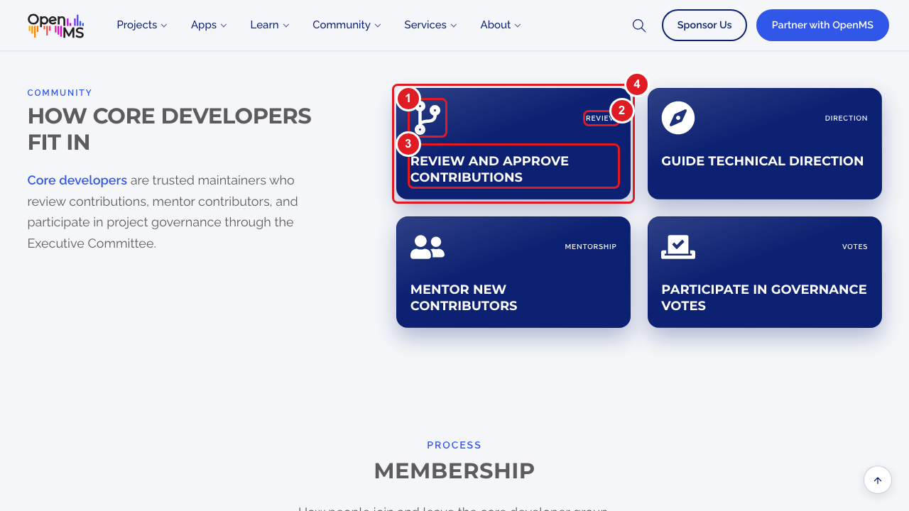
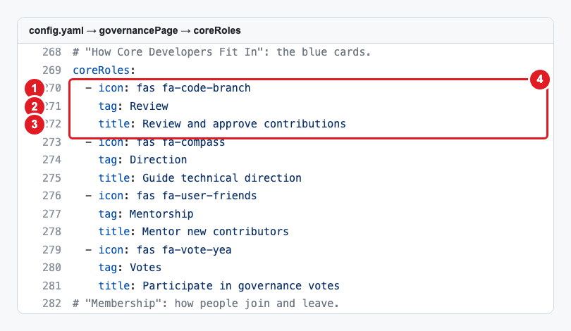

# Add or change the cards on the Governance page

The page **https://openms.de/governance/** (top menu → **About** → **Governance**) has four groups of cards. Each card is a small block in `config.yaml`, under `governancePage`. You can change the words, add a card or remove one.

**You will change:** a few lines in `config.yaml`  ·  **Time:** about 10 minutes  ·  **Skills needed:** none

**On the website** ("How Core Developers Fit In")

**In `config.yaml`**

The numbers match: the part marked **1** on the website is the line marked **1** in the file.

| Number | What it is | Line |
|:--:|------------|------|
| 1 | The icon | `icon:` |
| 2 | The small word in the corner | `tag:` |
| 3 | The card title | `title:` |
| 4 | One whole card | from `- icon:` down to the line before the next `- icon:` |

## The four groups

| Section on the page | List in `governancePage` | Lines in each card |
|---------------------|--------------------------|--------------------|
| **Two layers of governance** (white cards, numbered 01, 02…) | `layers` | `title`, `text`, `points` (the bullet list, one `- ` line per bullet), `linkText` and `linkUrl` (the link at the bottom). The numbers are added automatically. |
| **How Core Developers Fit In** (blue cards) | `coreRoles` | `icon`, `tag`, `title` (and optionally `text`) |
| **Membership** (Joining, Leaving) | `membership` | `icon`, `tag`, `text` |
| **Separation of Responsibilities** | `responsibilities` | `icon`, `tag`, `title`, `text` |

The section titles and the sentence under each title ("Two layers of governance", "This model gives OpenMS…") are part of the design (`layouts/partials/governance-main.html`). To change them, ask the web team ([Who to ask](../../workflow/who-to-ask.md)).

## Step by step

1. Open **https://github.com/OpenMS/OpenMS-website/blob/main/config.yaml** and click the **pencil icon**. ([Need help?](../../getting-started/edit-via-github.md#step-1--open-the-file))
2. Press **Ctrl + F** (Windows) or **Cmd + F** (Mac) and search for `governancePage:`. The four lists follow, each with a comment line (`#`) saying which section it is.
3. **To change a card**, change only the words after the colon.
4. **To add a card**, copy a whole card (from its `- ` line down to the line before the next `- `), paste it under the last card of the same list and change the words. Keep the spaces at the start of each line exactly as in the card you copied. See [Spaces matter](../../getting-started/edit-via-github.md#spaces-matter-in-configyaml).
5. **To remove a card**, delete all its lines.
6. Save and send for review: [How to make a change, steps 3 to 6](../../getting-started/edit-via-github.md#step-3--save-commit-changes).
7. Open the **Deploy Preview** and check **/governance/** on a laptop and on a phone.

## Icons

An icon is a Font Awesome name, for example `fas fa-users` or `fas fa-book`. Search for one on **https://fontawesome.com/v5/search?m=free** (version 5, free icons) and copy its name, starting with `fas`, `far` or `fab`.

## Good to know

- Any number of cards works: the cards wrap onto new rows on smaller screens.
- Keep titles short (two to five words) so the cards in a row stay a similar height.
- In **Two layers of governance**, a card without `linkUrl` has no link; a card without `points` has no bullet list.

## Related guides

- [Change the intro text of the Governance page](edit-intro-text.md)
- [Which files are behind this page](../../reference/file-locations.md#everything-in-the-navbar-and-the-footer-where-is-each-page)
- Back to the [list of all tasks](../README.md)
