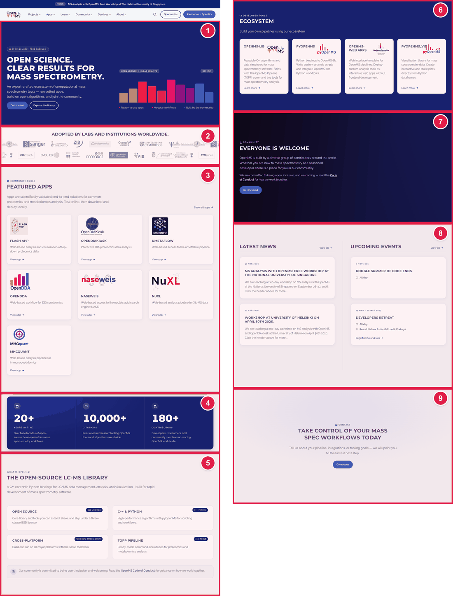

# Home page

The home page (**https://openms.de/**) is built from **blocks**, one under the other. The words in most blocks live in **one file: `config.yaml`**. You find the block you want by searching for a short key word.

## Which block do I want?

| Number | Block on the page | Search for this word in `config.yaml` | Guide |
|:--:|-------------------|--------------------------------------|-------|
| 1 | **Top banner** ("Open science. Clear results…") | `hero:` | [Edit the top banner](edit-top-banner.md) |
| 2 | **Adopted by labs and institutions** (logos) | `universityPartners` | [Add, change or remove a logo](update-adopted-by-logos.md) |
| 3 | **Featured Apps** | `webapps` | [Featured Apps](../featured-apps/update-featured-apps.md) (the same list as the Featured Apps page) |
| 4 | **Three big numbers** (20+, 10,000+, 180+) | `homeMetrics` | [Change the three big numbers](update-big-numbers.md) |
| 5 | **What is OpenMS?** (four boxes) | `keyfeatures` | [Edit "What is OpenMS?"](edit-what-is-openms.md) |
| 6 | **Ecosystem** (OpenMS-lib, pyOpenMS…) | `ecosystemSection` | [Edit the Ecosystem block](edit-ecosystem.md) |
| 7 | **Everyone is welcome** | `communitySection` | [Edit "Everyone is welcome"](edit-everyone-is-welcome.md) |
| 8 | **Latest news** and **Upcoming events** | `newsSection`, `eventsSection` | [Edit the news and events blocks](edit-news-and-events-blocks.md) |
| 9 | **"Take control of your mass spec workflows"** (contact) | *not in `config.yaml`* | Ask the web team. |

The announcement bar and the top menu are on every page: see [Navbar](../navbar/). The footer: see [Footer](../footer/).

## How to change any block

The same steps work for every block. Only the key word you search for is different.

1. Open **https://github.com/OpenMS/OpenMS-website/blob/main/config.yaml** and click the **pencil icon**. (Need help? [How to make a change, step 1](../../getting-started/edit-via-github.md#step-1--open-the-file))
2. Click once inside the text box, press **Ctrl + F** (Windows) or **Cmd + F** (Mac) and type the key word from the table.
3. Change **only the words after the colon**. Keep the quotes and the spaces at the start of each line. See [Spaces matter](../../getting-started/edit-via-github.md#spaces-matter-in-configyaml).
4. Save and send for review: [How to make a change, steps 3 to 6](../../getting-started/edit-via-github.md#step-3--save-commit-changes).
5. Open the **Deploy Preview** and check the home page.

> **Tip:** the search often finds the key word in several places. Use the one that **starts at the left** (a line like `hero:` with nothing before it except spaces) and is followed by indented lines.

## Common mistakes

| What went wrong | How to fix it |
|-----------------|---------------|
| The preview says **Failed** | A quote or colon is wrong. A text with a `:` inside must be inside double quotes: `"Note: this"`. |
| My text shows twice, or the highlight is missing | `titleHighlight` must be words that really appear in the title. |
| A button goes to the wrong place | A link to another website must start with `https://`. For this website it must start with `/`. |
| I can't find the key word | Make sure you clicked inside the text box before pressing Ctrl+F or Cmd+F. |

## Leave these to the web team

The **order** of the blocks and their **colours and spacing** are not in `config.yaml`. If you want them changed, ask. See [Who to ask](../../workflow/who-to-ask.md).

Back to the [list of all tasks](../README.md)
