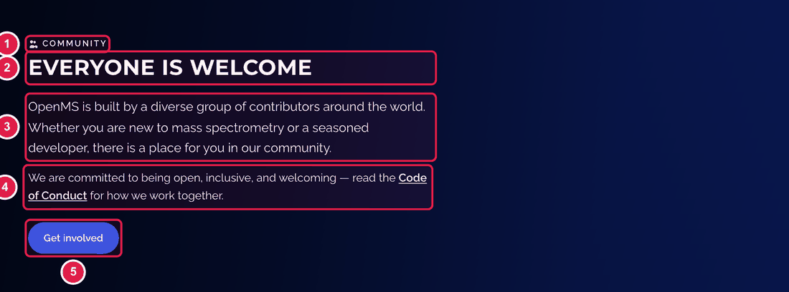
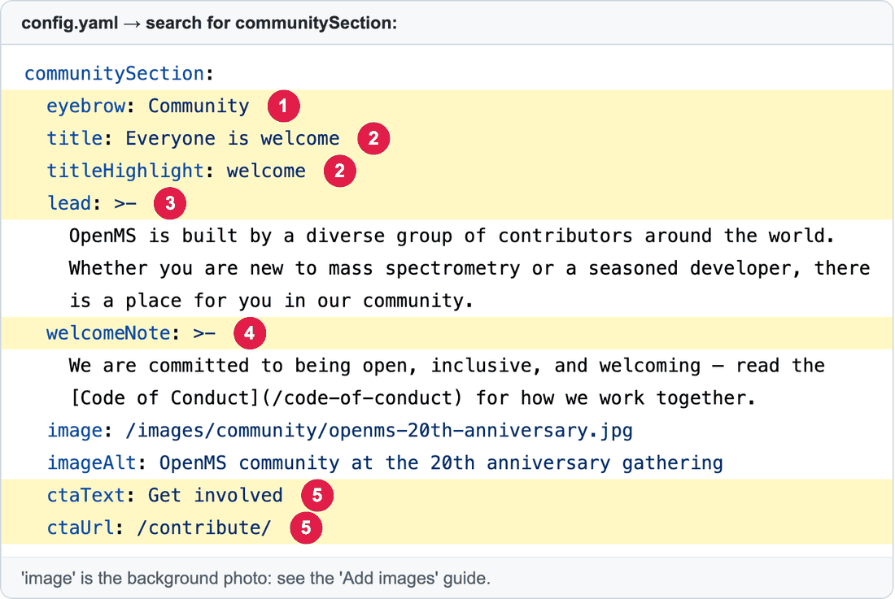

# Edit "Everyone is welcome" on the home page

The block with the community photo, two short paragraphs and a button.

**You will change:** a few lines in `config.yaml` (search for `communitySection`)  ·  **Time:** about 10 minutes  ·  **Skills needed:** none

| Number | Line | What it is |
|:--:|------|-----------|
| 1 | `eyebrow:` | Small label. |
| 2 | `title:` and `titleHighlight:` | The headline. The highlighted word must also appear in the title. |
| 3 | `lead:` | The first paragraph. |
| 4 | `welcomeNote:` | The second paragraph. A link is written `[words](/page/)`. |
| 5 | `ctaText:` and `ctaUrl:` | The button's words and where it goes. |

## Step by step

Follow [How to change any block](README.md#how-to-change-any-block), searching for `communitySection`.

**Change the photo:** first add the new picture (see [Add images](../any-page/add-images.md)), then change the `image:` line to its address, and `imageAlt:` to a short description of the photo.

## Related guides

- [All the blocks of the home page](README.md)
- Back to the [list of all tasks](../README.md)
