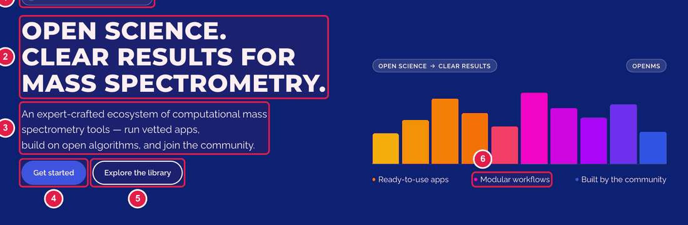
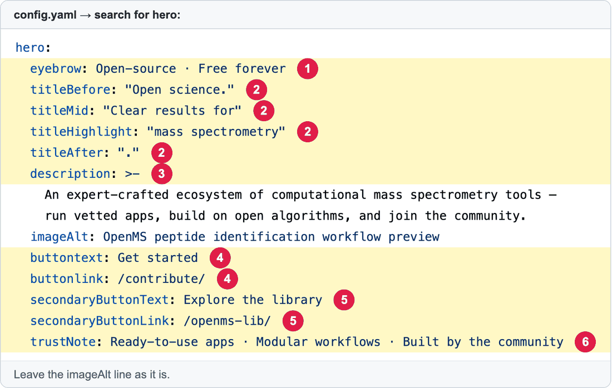

# Edit the top banner of the home page

The big banner at the top of the home page: headline, short text and two buttons.

**You will change:** a few lines in `config.yaml` (search for `hero:`)  ·  **Time:** about 10 minutes  ·  **Skills needed:** none





| Number | Line(s) | What it is |
|:--:|---------|-----------|
| 1 | `eyebrow:` | The small label above the headline. |
| 2 | `titleBefore:`, `titleMid:`, `titleHighlight:`, `titleAfter:` | The headline, in four pieces joined together. `titleHighlight` is shown in a different colour. |
| 3 | `description:` | The paragraph under the headline. Several lines are fine. Keep them indented. |
| 4 | `buttontext:` and `buttonlink:` | The first button: its **words** and **where it goes**. |
| 5 | `secondaryButtonText:` and `secondaryButtonLink:` | The second (outlined) button. |
| 6 | `trustNote:` | The three short phrases under the buttons, separated by `·`. |

## Step by step

Follow [How to change any block](README.md#how-to-change-any-block), searching for `hero:`.

**Before**

```yaml
buttontext: Get started
buttonlink: /contribute/
```

**After**

```yaml
buttontext: Download OpenMS
buttonlink: https://openms.readthedocs.io/en/latest/about/installation.html
```

For a link to another page of this website, start with `/` (for example `/contribute/`). For another website, use the full address starting with `https://`.

## Related guides

- [All the blocks of the home page](README.md)
- Back to the [list of all tasks](../README.md)
