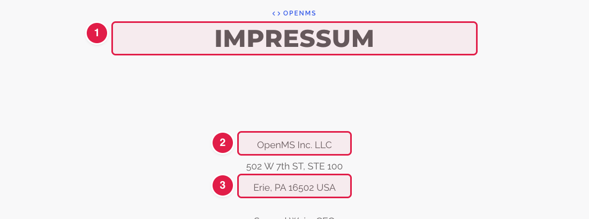
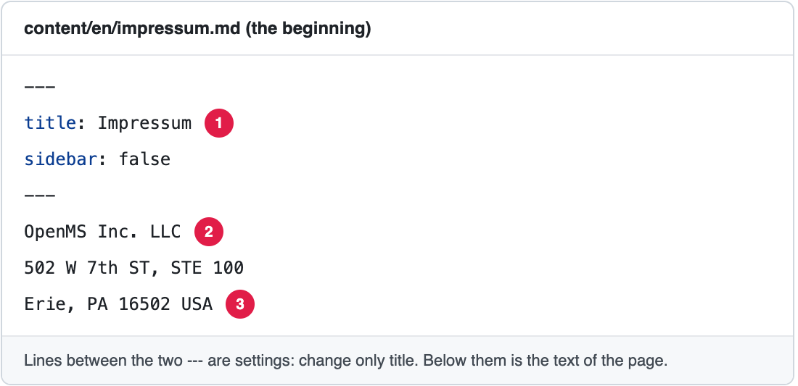

# Change the text of the Impressum page

The page **https://openms.de/impressum/** (footer → **LEGAL**) has **all its words in one page file**: `content/en/impressum.md`.

**You will change:** a few words in one file  ·  **Time:** about 10 minutes  ·  **Skills needed:** none

**On the website**

**In the page file**

The numbers match: the part marked **1** on the website is the line marked **1** in the file.

## What you will change

| In the file | On the page |
|---|---|
| `title:` between the two `---` lines | The big title. |
| A line starting with `## ` | A section heading. |
| A normal line | A paragraph of text. |

Each line of the address is its own paragraph: keep an **empty line** between them.

## Step by step

1. Open **https://github.com/OpenMS/OpenMS-website/blob/main/content/en/impressum.md** and click the **pencil icon**. ([Need help?](../../getting-started/edit-via-github.md#step-1--open-the-file))
2. Find your sentence (**Ctrl + F** on Windows or **Cmd + F** on Mac, after clicking inside the text box).
3. Change the words, like in a Word document.
4. Save and send for review: [How to make a change, steps 3 to 6](../../getting-started/edit-via-github.md#step-3--save-commit-changes).
5. Open the **Deploy Preview** and check **/impressum/**.

## Do not touch

- The top block between the two lines of `---` (except the `title:` if you want a new title).
- Lines that start with `{{<`. They are special building blocks. Ask the web team.

## Related guides

- [Change the text of a page](../any-page/edit-page-text.md): a picture of a page next to its file, and the writing symbols you can use (bold, links, lists…)
- Back to the [list of all tasks](../README.md)
