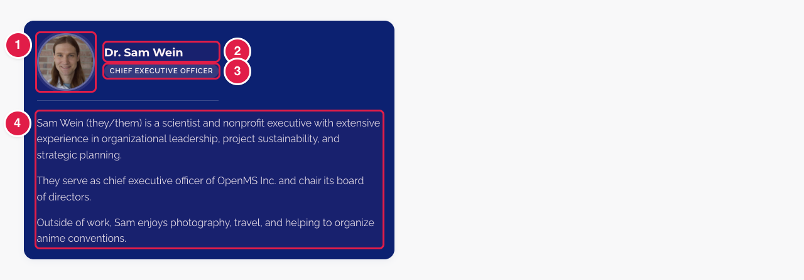
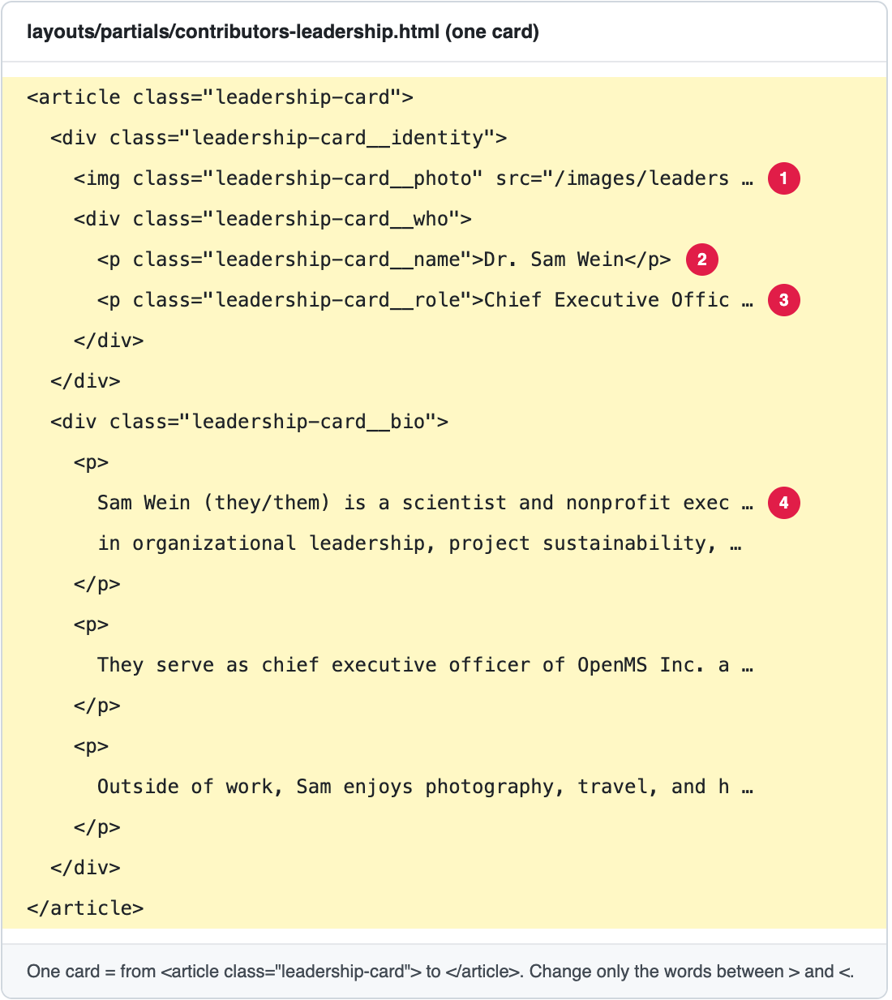

# Update the board of directors

The page **Leadership** has the address **https://openms.de/contributors/** (top menu → **About** → **Leadership**). Its first part, **Board of directors**, shows one **card** per person: a photo, a name, a role and a short text (the bio).

**You will change:** one block in `layouts/partials/contributors-leadership.html`, and upload a photo  ·  **Time:** about 15 minutes  ·  **Skills needed:** none, but be careful with the `<` `>` signs

**On the website**



**In the file**



| Number | In the file | What it is |
|:--:|-------------|-----------|
| 1 | `src="/images/leadership_photos/…"` | The photo. The file is in `static/images/leadership_photos/`. |
|  | `alt="Portrait of …"` | A short description of the photo for people who cannot see it. Keep it as "Portrait of" and the name. |
| 2 | `<p class="leadership-card__name">…</p>` | The name. |
| 3 | `<p class="leadership-card__role">…</p>` | The role, for example *Treasurer*. |
| 4 | each `<p>…</p>` inside `leadership-card__bio` | One paragraph of the bio. |

This file is a **design file** (HTML), not a text file. Change **only the words between `>` and `<`**, and the photo address. Do not delete or move any `<…>` part.

## Change a name, role or bio

1. Open **https://github.com/OpenMS/OpenMS-website/blob/main/layouts/partials/contributors-leadership.html** and click the **pencil icon**. ([Need help?](../../getting-started/edit-via-github.md#step-1--open-the-file))
2. Press **Ctrl + F** (Windows) or **Cmd + F** (Mac), after clicking inside the text box, and search for the person's name.
3. Change the words between `>` and `<`.
4. Save and send for review: [How to make a change, steps 3 to 6](../../getting-started/edit-via-github.md#step-3--save-commit-changes).
5. Open the **Deploy Preview** and check **/contributors/**.

## Add a person

1. **Upload the photo** to **`static/images/leadership_photos/`** (see [Add images](../any-page/add-images.md)). Use a portrait with the same shape as the other photos, and a file name like `first_last.jpeg` (small letters, no spaces).
2. **Open the file** as above.
3. **Copy a whole card**: from the line `<article class="leadership-card">` down to its `</article>` (about 20 lines). Paste it **just before** the `</div>` on the last line of the file, or between two cards to put the person in that place. The cards are shown in the order of the file.
4. **Change the copy**: the photo address (`/images/leadership_photos/first_last.jpeg`), the `alt` text, the name, the role and the bio paragraphs. To have fewer paragraphs, delete a whole `<p>…</p>`; to have more, copy one.
5. **Save, send for review, and check** the Deploy Preview.

The copied card looks like this:

```html
    <article class="leadership-card">
      <div class="leadership-card__identity">
        
        <div class="leadership-card__who">
          <p class="leadership-card__name">First Last</p>
          <p class="leadership-card__role">Role</p>
        </div>
      </div>
      <div class="leadership-card__bio">
        <p>
          First paragraph of the bio.
        </p>
      </div>
    </article>
```

## Remove a person

Delete their whole card, from `<article class="leadership-card">` to its `</article>`. You can also delete their photo from `static/images/leadership_photos/`.

## Replace a photo

1. Give the new photo **exactly the same file name** as the old one (for example `sam_wein.jpeg`).
2. Upload it to **`static/images/leadership_photos/`** and confirm that it replaces the old file. See [Add images, replace a picture](../any-page/add-images.md#replace-a-picture-that-is-already-there).
3. Open the **Deploy Preview** and check **/contributors/**. If you still see the old photo, reload the page.

## Common mistakes

| What went wrong | How to fix it |
|-----------------|---------------|
| The page looks broken after my change | A `<` or `>` was deleted, or a card was not copied to its `</article>`. Compare with another card, or close the pull request and start again. |
| The photo does not show | The address after `src=` must match the file name exactly, including `.jpg` or `.jpeg` and small or capital letters. |
| One photo is cropped differently | Joshua Charkow's photo has an extra class (`leadership-card__photo--joshua`) that moves the crop to show the face. Do not copy that class to a new card. If a new photo needs it, ask the web team. |

## Leave these to the web team

The headings and text above the cards ("Nonprofit", "Board of directors", "The board provides…") are in `layouts/partials/contributors-main.html`. Ask the web team ([Who to ask](../../workflow/who-to-ask.md)).

## Related guides

- [Update the Executive Committee](update-executive-committee.md)
- [Add a picture or logo](../any-page/add-images.md)
- Back to the [list of all tasks](../README.md)
