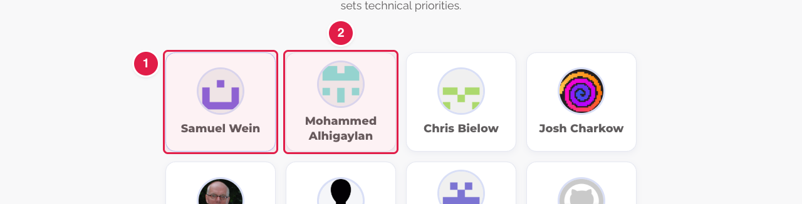
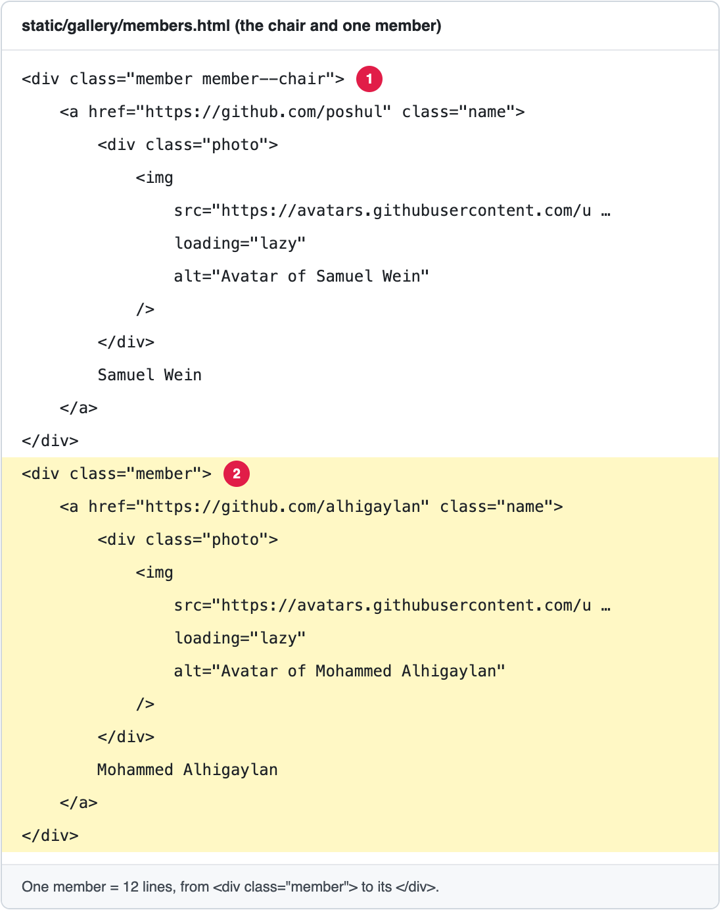

# Update the Executive Committee

The page **Leadership** (**https://openms.de/contributors/**) has a second part, **Executive Committee**. It shows each member with their **GitHub picture** and **name**. Clicking a member opens their GitHub profile. The **chair** comes first and has a coloured border.

**You will change:** one block in `static/gallery/members.html`  ·  **Time:** about 10 minutes  ·  **Skills needed:** none, but be careful with the `<` `>` signs

**On the website**



**In the file**



| Line in the file | What it is |
|------------------|-----------|
| `<a href="https://github.com/…"` | The member's GitHub profile: where the card goes when clicked. |
| `src="https://avatars.githubusercontent.com/…"` | The picture. It is the member's GitHub picture. |
| `alt="Avatar of …"` | A short description of the picture. Keep it as "Avatar of" and the name. |
| The name on its own line, before `</a>` | The name shown under the picture. |
| `<div class="member member--chair">` | The chair. Every other member has `<div class="member">`. |

This file is HTML. Change **only the words and addresses**, and do not delete or move any `<…>` part.

## Add a member

1. Open **https://github.com/OpenMS/OpenMS-website/blob/main/static/gallery/members.html** and click the **pencil icon**. ([Need help?](../../getting-started/edit-via-github.md#step-1--open-the-file))
2. **Copy one member**: from `<div class="member">` down to its `</div>` (12 lines, ending after `</a>`). Paste it where the person goes. The members are listed **by last name**, after the chair.
3. **Change the copy**, replacing `username` with the person's GitHub user name and `First Last` with their name:

```html
        <div class="member">
            <a href="https://github.com/username" class="name">
                <div class="photo">
                    
                </div>
                First Last
            </a>
        </div>
```

   The picture address `https://github.com/username.png?size=96` always shows the person's current GitHub picture. (The older members use a longer `avatars.githubusercontent.com` address. Both work.)

4. Save and send for review: [How to make a change, steps 3 to 6](../../getting-started/edit-via-github.md#step-3--save-commit-changes).
5. Open the **Deploy Preview** and check **/contributors/**. Click the new member to check that their GitHub profile opens.

## Remove a member

Delete their whole block, from `<div class="member">` to its closing `</div>` (12 lines). Keep the empty line between the remaining members.

## Change the chair

1. On the current chair, change `<div class="member member--chair">` to `<div class="member">`.
2. Move the new chair's block to the **top of the list** (just under `<div class="members">`), and change its first line to `<div class="member member--chair">`.

## Change a name or picture

- **Name:** change the name on its own line before `</a>`, and in `alt="Avatar of …"`.
- **Picture:** the picture is the person's GitHub picture. They change it on GitHub. If the page still shows the old one, replace the `src=` address with `https://github.com/username.png?size=96`.

## Common mistakes

| What went wrong | How to fix it |
|-----------------|---------------|
| The members after mine look wrong | A `</div>` is missing. Each member needs exactly the 12 lines of the example. |
| The picture is broken | The GitHub user name in the `src=` address is wrong. Open `https://github.com/username` to check it. |
| Two members have a coloured border | Only the chair has `member--chair`. Remove it from the other one. |

## Leave these to the web team

The headings and text above the list ("Scientific Leadership", "Executive Committee", "The Executive Committee leads…") and the link to the Governance page are in `layouts/partials/contributors-main.html`. Ask the web team ([Who to ask](../../workflow/who-to-ask.md)).

The rules of the committee are on its own page: [Change the text of the Executive Committee Charter](../executive-committee-charter/edit-text.md).

## Related guides

- [Update the board of directors](update-board-of-directors.md)
- Back to the [list of all tasks](../README.md)
