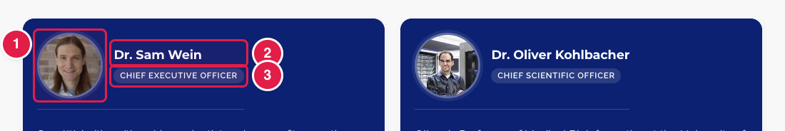

# Update the Leadership page

The page **Leadership** has the address **https://openms.de/contributors/** (top menu → **About** → **Leadership**). It shows the board of directors and the Executive Committee, each person with a photo, a name, a role and a short text.

**You will change:** a photo in `static/images/leadership_photos/`  ·  **Time:** about 10 minutes  ·  **Skills needed:** none

Only the **photo** (1) is a file you can replace yourself. The name (2), the role (3) and the short text are part of the design.

## What you will change

| Part of the page | Where it is | Who changes it |
|---|---|---|
| A person's photo | `static/images/leadership_photos/` | You (see below) |
| Names, roles and short texts | `layouts/partials/contributors-leadership.html`, `contributors-exec.html` | The web team ([Who to ask](../../workflow/who-to-ask.md)) |
| Adding or removing a person | the same design files | The web team ([Who to ask](../../workflow/who-to-ask.md)) |

## Replace a photo

1. Get the new photo ready: a portrait with the same shape as the current photos, as a `.jpg` or `.jpeg` file.
2. Give it **exactly the same file name** as the old one (for example `sam_wein.jpeg`). The page then shows the new photo without any other change.
3. Upload it to the folder **`static/images/leadership_photos/`** and confirm that it replaces the old file. See [Add images, replace a picture](../any-page/add-images.md#replace-a-picture-that-is-already-there).
4. Open the **Deploy Preview** and check **/contributors/**. If you still see the old photo, reload the page.

To add a new person, send the web team the photo, the name, the role and a short text.

## Related guides

- [Add a picture or logo](../any-page/add-images.md)
- Back to the [list of all tasks](../README.md)
