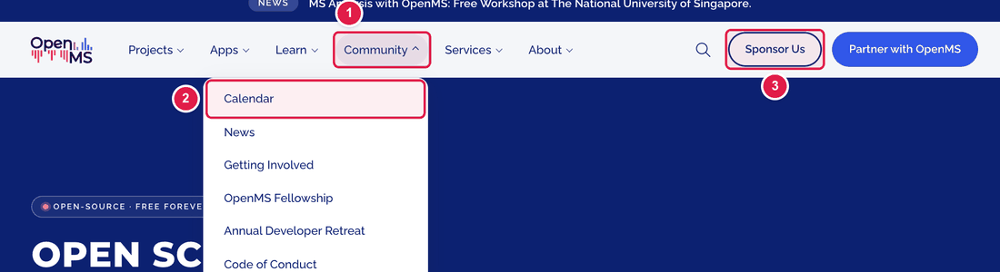
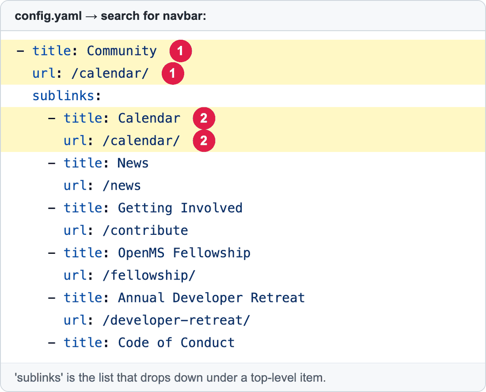

# Change the top menu (navbar)

The **menu at the top** of every page (Projects, Apps, Learn, Community…) is called the **navbar**. It is written in `config.yaml`. Because it appears everywhere, a change here is seen on the whole website.

**You will change:** a few lines in `config.yaml`  ·  **Time:** about 10 minutes  ·  **Skills needed:** none



1. A **top-level item** (clicking it opens the list below).
2. One **line inside the drop-down list**.
3. A **button** at the right (for example *Sponsor Us*).

The same menu in `config.yaml`:



| Number | Lines | What it is |
|:--:|-------|-----------|
| 1 | `title:` and `url:` at the left | The top-level item's name, and the page it opens when clicked. |
| 2 | `title:` and `url:` under `sublinks:` | One line in the drop-down list. |

## Change a menu item

1. Open **https://github.com/OpenMS/OpenMS-website/blob/main/config.yaml** and click the **pencil icon**. ([Need help?](../../getting-started/edit-via-github.md#step-1--open-the-file))
2. Click inside the text box, press **Ctrl + F** (Windows) or **Cmd + F** (Mac) and search for `navbar:`.
3. Change the words after `title:` (what people read) or after `url:` (where it goes).
4. Save and send for review: [How to make a change, steps 3 to 6](../../getting-started/edit-via-github.md#step-3--save-commit-changes).

## Add a line to a drop-down list

Copy two lines under `sublinks:` and change them:

```yaml
            - title: My new page
              url: /my-new-page/
```

Keep the spaces at the start exactly the same as the lines above. The new line must start with `- title:` lined up with the others.

For a link to **another website**, use the full address and add a line `is_external: true` (it then opens with a small arrow icon):

```yaml
            - title: Glossary
              url: https://openms.readthedocs.io/en/latest/manual/glossary.html
              is_external: true
```

## Remove a line

Delete its two lines (`- title:` and `url:`).

## Other parts of the navbar

| Part | Search for | What you can change |
|------|-----------|---------------------|
| The announcement bar above the menu | `newsBanner` | See [Change the announcement bar](update-announcement-bar.md). |
| The logo (top left) | `navbarlogo` | `link:` (where it goes). To change the picture, ask the web team. |
| The search box | `navbarSearch` | `placeholder:` (the grey hint text), `enabled:` (`true` to show it, `false` to hide it). |
| The social icons in the phone menu | `socialmedia` | They are the same as in the footer: see [Change the social media icons](../footer/edit-social-icons.md). |

## Where is the page behind a link?

For every item of the menu, which files hold its page, design, words and styling: see [Everything in the navbar and the footer](../../reference/file-locations.md#everything-in-the-navbar-and-the-footer-where-is-each-page).

## Check the result

Open the **Deploy Preview**. Look at the **home page** and **one inner page** (the menu is on all pages). Click each link you changed.

## Common mistakes

| What went wrong | How to fix it |
|-----------------|---------------|
| The preview says **Failed** | The spaces at the start of a line are wrong. Compare with the lines above. See [Spaces matter](../../getting-started/edit-via-github.md#spaces-matter-in-configyaml). |
| A link opens "page not found" | Check `url:`. A page of this website starts with `/`, for example `/calendar/`. Another website starts with `https://`. |
| The menu looks different on a phone | That is normal. The same list is shown differently on small screens. |

## Leave these to the web team

The **logo** picture, the **colours**, and how the menu opens and closes. See [Who to ask](../../workflow/who-to-ask.md).

## Related guides

- [Change the announcement bar](update-announcement-bar.md)
- [Change the footer links](../footer/edit-footer-links.md)
- Back to the [list of all tasks](../README.md)
