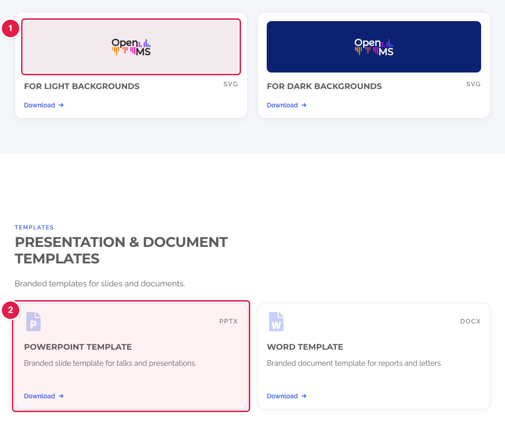

# Replace a file on the Press kit page

The page **https://openms.de/press-kit/** (footer → **LEGAL** → **Press kit**) offers logos and templates to download. The files are in the folder **`static/press-kit/`**.

**You will change:** one file in `static/press-kit/`  ·  **Time:** about 10 minutes  ·  **Skills needed:** none

## The files

| On the page | File |
|---|---|
| Corporate design guide (the button at the top) | `OpenMS_CorporateDesign_current.pdf` |
| Logo for light backgrounds | `OpenMS_Logo_Light.svg` |
| Logo for dark backgrounds | `OpenMS_Logo_Dark.svg` |
| PowerPoint template | `OpenMS_PPT_Template.pptx` |
| Word template | `OpenMS_Word_Template.docx` |

## Replace a file

1. Name the new file **exactly like the old one** (see the table). The page then offers the new file without any other change.
2. Upload it to **`static/press-kit/`** and confirm that it replaces the old file. The steps are the same as for pictures: [Add images, replace a picture](../any-page/add-images.md#replace-a-picture-that-is-already-there).
3. Save and send for review: [How to make a change, steps 3 to 6](../../getting-started/edit-via-github.md#step-3--save-commit-changes).
4. Open the **Deploy Preview**, go to **/press-kit/** and click the download to check it.

The **words** of the page and **adding a new download** are part of the design (`layouts/partials/press-kit-main.html`). Ask the web team ([Who to ask](../../workflow/who-to-ask.md)).

## Related guides

- Back to the [list of all tasks](../README.md)
