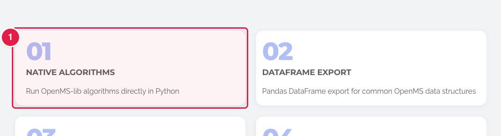
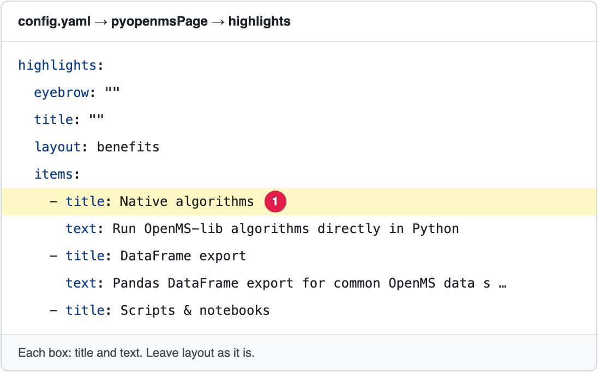

# Change the blocks of the pyOpenMS page

The page **https://openms.de/pyopenms/** (top menu → **Projects** → **pyOpenMS**) is made of blocks, one under the other. Most of its words are in `config.yaml`.

**You will change:** a few lines in `config.yaml`  ·  **Time:** about 10 minutes  ·  **Skills needed:** none

**On the website**

**In `config.yaml`**

The numbers match: the part marked **1** on the website is the line marked **1** in the file.

## What you will change

| Block on the page | Search for | Lines you can change |
|---|---|---|
| Highlights | `pyopenmsPage` → `highlights` | `items`: each box has `title` and `text` |
| Getting started | `pyopenmsPage` → `gettingStarted` | `title`, `lead`, and the cards under `items` |
| For developers, and the citation | `pyopenmsPage` → `developers` | `title`, `lead`, `citeText`, the paper under `citation`, and the cards under `boxes`. Any number of boxes works: the usual numbers have their own layout, others sit in equal columns (3 or 4 per row on a laptop, 1 on a phone). A box with `type: links` shows its `platforms` as stacked buttons. |

The **big title at the top** is part of the design (`layouts/partials/pyopenms-hero.html`). To change it, ask the web team ([Who to ask](../../workflow/who-to-ask.md)).

In each block, change the words after `title:`, `lead:`, `text:` and similar lines. Leave lines like `layout:`, `icon:`, `accent:`, `featured:` or `group:` as they are: they set how the block looks.

To **add a card**, copy a whole card (from its `- title:` line to the line before the next `- title:`), paste it under the last one and change the words. To **remove a card**, delete all its lines.

## Step by step

1. Open **https://github.com/OpenMS/OpenMS-website/blob/main/config.yaml** and click the **pencil icon**. ([Need help?](../../getting-started/edit-via-github.md#step-1--open-the-file))
2. Click inside the text box, press **Ctrl + F** (Windows) or **Cmd + F** (Mac) and search for `pyopenmsPage`.
3. Change **only the words after the colon**. Keep the quotes and the spaces at the start of each line. See [Spaces matter](../../getting-started/edit-via-github.md#spaces-matter-in-configyaml).
4. Save and send for review: [How to make a change, steps 3 to 6](../../getting-started/edit-via-github.md#step-3--save-commit-changes).
5. Open the **Deploy Preview** and check **/pyopenms/**.

## Related guides

- [Which files are behind this page](../../reference/file-locations.md#everything-in-the-navbar-and-the-footer-where-is-each-page)
- Back to the [list of all tasks](../README.md)
