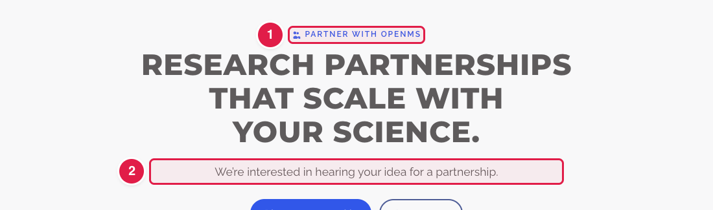
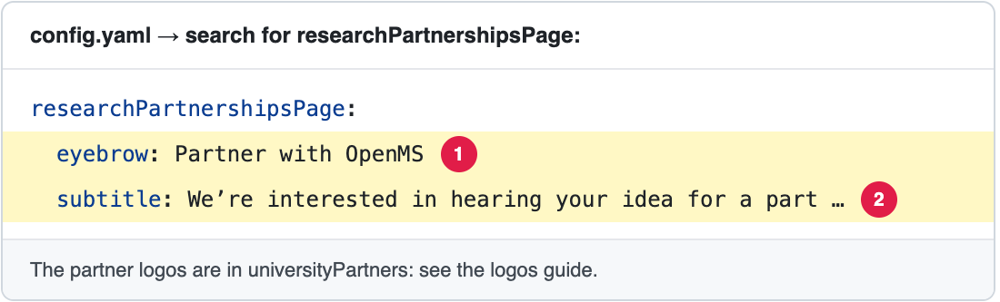

# Change the intro of the Research Partnerships page

The page **https://openms.de/research-partnerships/** explains how research groups can work with OpenMS and shows the **partner logos**.

**You will change:** a few lines in `config.yaml`  ·  **Time:** about 10 minutes  ·  **Skills needed:** none

**On the website**

**In `config.yaml`**

The numbers match: the part marked **1** on the website is the line marked **1** in the file.

## What you will change

| Part of the page | Search for | Lines |
|------------------|-----------|-------|
| The small word above the title, and the intro | `researchPartnershipsPage:` | `eyebrow`, `subtitle` |
| The partner logos ("Adopted by labs and institutions worldwide") | `universityPartners:` | One group of three lines per logo: `name`, `logo`, `url` |
| "Partnerships include" and the other texts | — | These are part of the design. Ask the web team ([Who to ask](../../workflow/who-to-ask.md)). |

> To add, change or remove a **partner logo**, see [Add, change or remove a partner logo](update-partner-logos.md). The logos are **the same list** as the moving logos on the home page, so a change there changes both.

## Step by step

1. Open **https://github.com/OpenMS/OpenMS-website/blob/main/config.yaml** and click the **pencil icon**. ([Need help?](../../getting-started/edit-via-github.md#step-1--open-the-file))
2. Click inside the text box, press **Ctrl + F** (Windows) or **Cmd + F** (Mac) and search for the word from the table.
3. Change **only the words after the colon**. Keep the quotes and the spaces at the start of each line. See [Spaces matter](../../getting-started/edit-via-github.md#spaces-matter-in-configyaml).
4. Save and send for review: [How to make a change, steps 3 to 6](../../getting-started/edit-via-github.md#step-3--save-commit-changes).
5. Open the **Deploy Preview** and check **/research-partnerships/** and the home page.

## Related guides

- [Add, change or remove a partner logo](update-partner-logos.md)
- Back to the [list of all tasks](../README.md)
