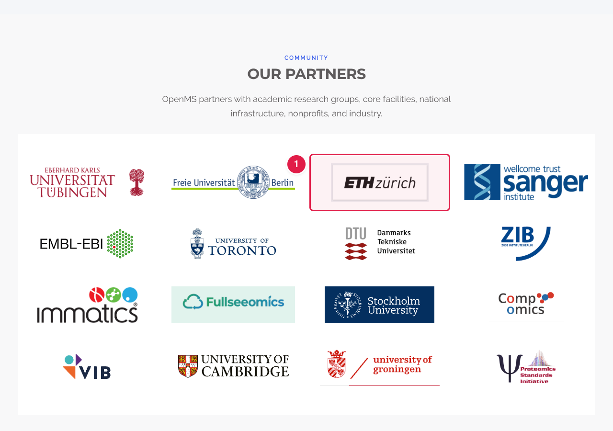
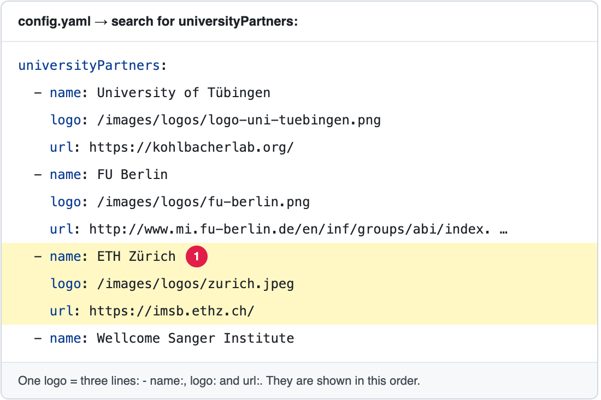

# Add, change or remove a partner logo

The page **Research Partnerships** (**https://openms.de/research-partnerships/**) shows the **partner logos** in the block **Our partners**. Each logo is **one small block** in `config.yaml`, and each logo is a link to that organisation's website.

**You will change:** one block in `config.yaml`, and upload one picture to add or change a logo  ·  **Time:** about 15 minutes  ·  **Skills needed:** none

> **The same list is used on the home page.** The logos in "Our partners" are the same as the moving logos "Adopted by labs and institutions worldwide" under the home page banner. Adding, changing or removing a logo here changes both places.

**On the website**



**In `config.yaml`**



| Line | What it is |
|------|-----------|
| `- name:` | The organisation's name. It is **not shown**, but screen readers read it aloud, and it is shown as a short label if the picture is missing. Each logo **starts with `-`**. |
| `logo:` | The picture. Its address starts with `/images/logos/` and ends with the file name you uploaded. |
| `url:` | The website that opens when someone clicks the logo. Leave it out and the logo is not a link. |

The logos are shown **in the order of the list**: the first block is the first logo.

## Add a logo

### Step 1 – Get a good logo picture

- A **PNG** (or SVG) with a **transparent or white background** looks best.
- A **wide** logo (about 2 to 3 times wider than tall) fits best. Very tall or square logos look small.
- Keep it under about **200 KB**.
- File name: small letters, numbers and `-` only, for example `logo-acme-university.png`.

### Step 2 – Upload it

Upload the picture to the folder **`static/images/logos/`**. Step by step with pictures: [Add images](../any-page/add-images.md).

### Step 3 – Add the block to `config.yaml`

1. Open **https://github.com/OpenMS/OpenMS-website/blob/main/config.yaml** and click the **pencil icon**. ([Need help?](../../getting-started/edit-via-github.md#step-1--open-the-file))
2. Click inside the text box, press **Ctrl + F** (Windows) or **Cmd + F** (Mac), and search for `universityPartners`.
3. Go to the **end of the last logo** (the next line that starts further left is `navbarlogo:`). Press **Enter** and paste:

```yaml
        - name: Acme University
          logo: /images/logos/logo-acme-university.png
          url: https://www.acme-university.example/
```

4. Replace the three values. The spaces at the start of each line must line up **exactly** with the logos above: the `-` goes under the other `-` signs. See [Spaces matter](../../getting-started/edit-via-github.md#spaces-matter-in-configyaml).

> To show the new logo **earlier**, paste the block higher up in the list instead of at the end.

### Step 4 – Save, send for review, and check

Save and send for review: [How to make a change, steps 3 to 6](../../getting-started/edit-via-github.md#step-3--save-commit-changes). In the **Deploy Preview**, check **both places**:

- [ ] **/research-partnerships/**, block "Our partners": the logo appears, is not blurry, and is not tiny next to the others.
- [ ] The **home page**, the moving logos: the logo appears there too.
- [ ] Clicking the logo opens the right website.

## Change a logo

- **New picture:** upload the new picture with a **new file name** (for example `logo-acme-university-2026.png`), then change the `logo:` line to that name. A new name makes sure every visitor sees the new picture at once, instead of an old copy kept by their browser. You can then delete the old picture from `static/images/logos/`.
- **New website:** change the `url:` line.
- **New name:** change the `name:` line.

## Remove a logo

Delete its **three lines** (`- name:`, `logo:` and `url:`). Leave the other blocks as they are. The logo disappears from this page **and** from the home page.

You can also delete the picture from `static/images/logos/`, but first make sure no other block uses it: search `config.yaml` for its file name.

## Common mistakes

| What went wrong | How to fix it |
|-----------------|---------------|
| The preview says **Failed** | The spaces at the start of a line are wrong, or a `-` is missing before `name:`. Compare with the blocks above. |
| A short label (two letters) shows instead of the logo | The `logo:` address does not match the file name. Check the spelling, small and capital letters, and `.png` / `.svg`. |
| The logo is tiny | The picture has a lot of empty space around it, or is square. Crop it, or use a wide version of the logo. |
| I see the old picture | Reload the page. If it is still old, upload the picture with a new file name (see *Change a logo*). |

## Leave these to the web team

The heading "Our partners" and the sentence under it, the size of the logos and the grid are part of the design (`layouts/partials/research-partnerships-main.html`, `layouts/partials/university-partners.html`). Ask the web team ([Who to ask](../../workflow/who-to-ask.md)).

## Related guides

- [Change the intro of the Research Partnerships page](edit-partners.md)
- [The same logos on the home page](../home-page/update-adopted-by-logos.md)
- [Add a picture or logo](../any-page/add-images.md)
- Back to the [list of all tasks](../README.md)
