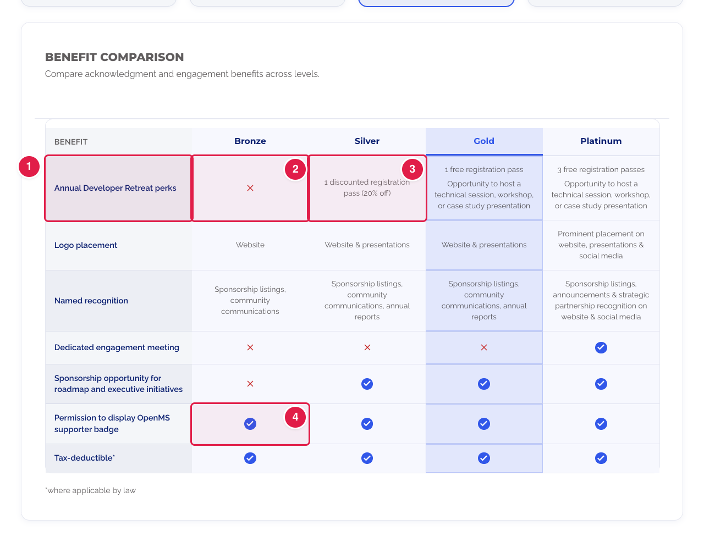
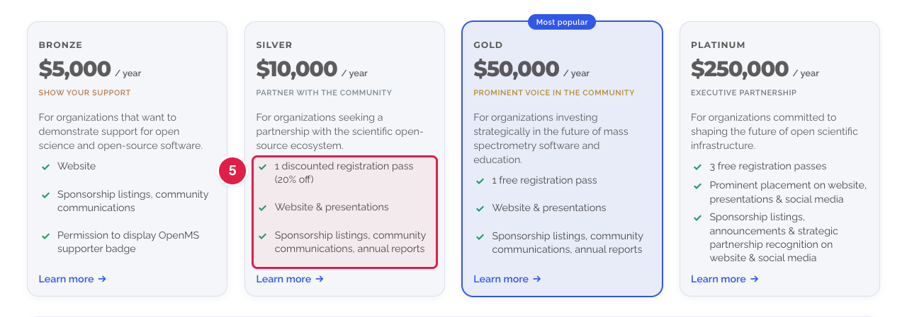
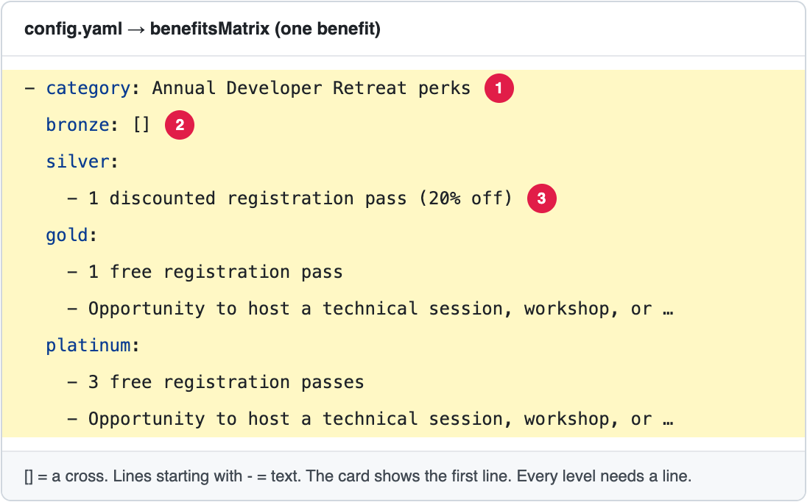
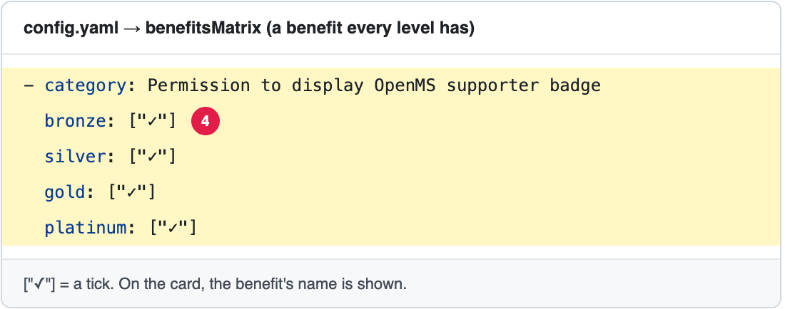

# Change the benefits of the sponsorship levels

The page **Our Sponsorship Program** (**https://openms.de/sponsor-us/**) shows what each sponsorship level (Bronze, Silver, Gold, Platinum) gets. The benefits are written **once**, in one list in `config.yaml` called `benefitsMatrix`, and the page shows them in **two places**:

- on each **level card**: the first 3 benefits of that level;
- in the **Benefit comparison** table under the cards: every benefit, for every level. Clicking a card, or a level's name at the top of the table, highlights that level's column.

**You will change:** a few lines in `config.yaml` (search for `benefitsMatrix:`)  ·  **Time:** about 15 minutes  ·  **Skills needed:** none

**On the website**





**In `config.yaml`**





## How one benefit is written

Each benefit is **one row** of the table. It starts with `- category:` (the name of the benefit), followed by **one entry per level**:

```yaml
          - category: Annual Developer Retreat perks
            bronze: []
            silver:
              - 1 discounted registration pass (20% off)
            gold:
              - 1 free registration pass
              - Opportunity to host a technical session, workshop, or case study presentation
            platinum:
              - 3 free registration passes
              - Opportunity to host a technical session, workshop, or case study presentation
```

What you write for a level decides what its cell shows:

| You write | The table shows | The level card shows |
|-----------|-----------------|----------------------|
| `bronze: []` | a **cross**: not included | nothing |
| `bronze: ["✓"]` | a **tick**: included | the **name** of the benefit (the `category`) |
| one or more lines starting with `- ` under `bronze:` | each line as **text** | the **first line** only |

The words `bronze`, `silver`, `gold` and `platinum` must be **exactly** the `id` of each level (search for `levels:`). Small letters, no spaces.

> **Every row needs a line for every level.** If a level has no line in a row (not even `[]`), the website **fails to build**. To say "not included", write `[]`.

## Change a benefit

1. Open **https://github.com/OpenMS/OpenMS-website/blob/main/config.yaml** and click the **pencil icon**. ([Need help?](../../getting-started/edit-via-github.md#step-1--open-the-file))
2. Click inside the text box, press **Ctrl + F** (Windows) or **Cmd + F** (Mac) and search for the name of the benefit, for example `Logo placement`.
3. Change what you need:
   - **The name of the benefit:** the words after `category:`.
   - **The text for one level:** the lines under that level. Keep the `- ` at the start of each line, and the same spaces as the lines around it.
   - **Give a level the benefit:** replace `[]` with `["✓"]`, or with text lines.
   - **Take the benefit away from a level:** replace what is after the level's name with `[]`, and delete its text lines. Do not delete the level's line itself.
4. Save and send for review: [How to make a change, steps 3 to 6](../../getting-started/edit-via-github.md#step-3--save-commit-changes).
5. Open the **Deploy Preview**, go to **/sponsor-us/**, and check both the cards and the table. Click each level to see its column.

## Add a benefit

1. Open `config.yaml` as above and search for `benefitsMatrix:`.
2. Copy a whole row, from its `- category:` line down to the line before the next `- category:`.
3. Paste it where the new benefit should go, and change it. The `-` of `- category:` must be under the other `-` signs.
4. Save, send for review, and check.

> **The order matters.** The table shows the benefits in the order of the list. The **cards** show only the **first 3** benefits that a level has, in that same order. To show a benefit on the cards, put it near the top.

## Remove a benefit

Delete its whole row, from `- category:` to the line before the next `- category:`. Check that the cards still show the 3 benefits you want.

## Add a new level (a new column)

1. Add the level under `levels:` (see [Change the sponsorship levels](update-levels.md)): copy a whole level, give it a new `id` (small letters, for example `diamond`), a name, a price, a motto and a text.
2. In `benefitsMatrix`, add a line for the new `id` to **every** row, for example `diamond: []`, `diamond: ["✓"]` or text lines. A row without it makes the build fail.
3. Save, send for review, and check the Deploy Preview at different screen sizes (see below).

## What happens with more benefits or more levels

Tested in October 2026 with 5 levels and 9 benefits:

| Screen | Level cards | Benefit comparison table |
|--------|-------------|--------------------------|
| **Large** (about 1440 px wide) | **4 per row**. A 5th level goes alone on a second row, on the left. | All levels side by side. Each column is about 200 px wide, and the page does not scroll sideways. |
| **Laptop** (about 1100 px) | **2 per row**. With an odd number of levels, the last one is alone. | All levels side by side, narrower (about 150 px each): long texts wrap onto more lines. |
| **Tablet and phone** (tested at 768 px and 375 px) | **1 per row**, one under the other. | **One level at a time**, chosen in a "Sponsorship level" list above the table. Any number of levels works. |

So:

- **More benefits (rows)** always work: the table only gets longer. Keep the names short, because on a phone the name column is narrow. Remember that each card shows only the first 3 benefits of its level.
- **More levels (columns)** work, but **4 levels look best** on a large screen. With 5 or more, the cards no longer fill one row, and each table column gets narrower. With 6 or more levels, ask the web team to check the layout first ([Who to ask](../../workflow/who-to-ask.md)).
- You can prepare a new level with `showInProgram: false`: it stays hidden until you change it to `true`.

## Other parts of the benefits

Search for these words in `config.yaml`, inside `sponsorTiers:`:

| Search for | What it is |
|------------|-----------|
| `benefitsTitle:` | The heading of the table ("Benefit comparison"). |
| `taxFootnote:` | The small note under the table ("*where applicable by law"). It explains the `*` in the benefit "Tax-deductible\*". If you remove that `*`, you can also empty this note. |
| `featuredLevel:` | The level with the **"Most popular"** badge, whose column is highlighted when the page opens. Write the level's `id`, for example `gold`. |
| `showInProgram:` (in each level under `levels:`) | `true` shows the level, `false` hides its card **and** its column. Use it to prepare a new level before it goes live. |

The sentence under the table heading ("Compare acknowledgment and engagement benefits across levels.") and the "Learn more" button are part of the design. Ask the web team to change them ([Who to ask](../../workflow/who-to-ask.md)).

## Common mistakes

| What went wrong | How to fix it |
|-----------------|---------------|
| The preview says **Failed** | The spaces at the start of a line are wrong, or a `-` is missing. Compare with the rows around it. See [Spaces matter](../../getting-started/edit-via-github.md#spaces-matter-in-configyaml). |
| The preview says **Failed** after adding a level or a benefit | A row has no line for one of the levels. Every row needs one line per level `id`, even if it is only `[]`. |
| A level shows a cross where it should have the benefit | Its lines are not indented under it, or the text after it is `[]`. |
| The tick shows as text "✓" | Write it exactly as `["✓"]`, with the square brackets and the quotes. |
| A benefit is missing on a card | The card shows only the first 3 benefits of that level. Move the row higher in the list. |

## Related guides

- [Add or change a question in the sponsorship FAQ](update-faq.md)
- [Change the sponsorship levels](update-levels.md) (name, price, motto, text of each level)
- [Add, change or remove a sponsor logo](../our-sponsors/update-sponsors.md)
- Back to the [list of all tasks](../README.md)
