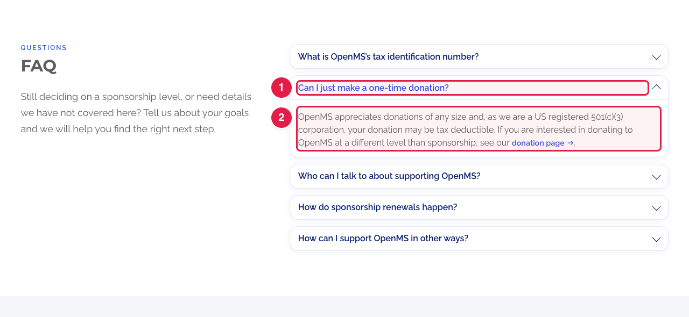
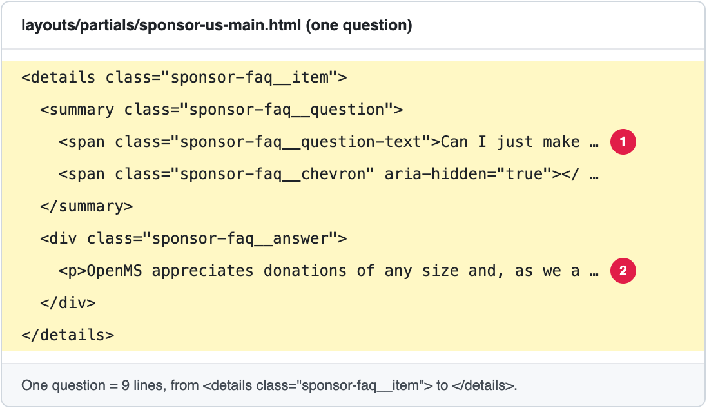

# Add or change a question in the sponsorship FAQ

The page **Our Sponsorship Program** (**https://openms.de/sponsor-us/**) ends with an **FAQ**: a list of questions. Clicking a question opens its answer.

The questions are written in a **design file** (HTML): `layouts/partials/sponsor-us-main.html`. Each question is **one block of 9 lines** that you can copy.

**You will change:** one block in `layouts/partials/sponsor-us-main.html`  ·  **Time:** about 15 minutes  ·  **Skills needed:** none, but be careful with the `<` `>` signs

**On the website**



**In the file**



| Number | In the file | What it is |
|:--:|-------------|-----------|
|  | `<details class="sponsor-faq__item">` … `</details>` | **One question** and its answer. Everything between these two lines belongs to it. |
| 1 | `<span class="sponsor-faq__question-text">…</span>` | The **question**. |
| 2 | `<p>…</p>` inside `<div class="sponsor-faq__answer">` | The **answer**. Use one `<p>…</p>` per paragraph. |

Change **only the words between `>` and `<`**. Do not delete or move any `<…>` part.

## Change a question or an answer

1. Open **https://github.com/OpenMS/OpenMS-website/blob/main/layouts/partials/sponsor-us-main.html** and click the **pencil icon**. ([Need help?](../../getting-started/edit-via-github.md#step-1--open-the-file))
2. Click inside the text box, press **Ctrl + F** (Windows) or **Cmd + F** (Mac) and search for a few words of the question.
3. Change the words between `>` and `<`.
4. Save and send for review: [How to make a change, steps 3 to 6](../../getting-started/edit-via-github.md#step-3--save-commit-changes).
5. Open the **Deploy Preview**, go to **/sponsor-us/**, scroll to **FAQ** and click the question to check the answer.

## Add a question

1. Open the file as above and search for `sponsor-faq__item`. You find the first question.
2. **Copy one whole question**: from `<details class="sponsor-faq__item">` down to its `</details>` (9 lines).
3. **Paste it** where the new question should go. The questions are shown in the order of the file: paste it just **after** a `</details>` line, or just before the first `<details`. The last question ends with `</details>` followed by a line `</div>`: paste new questions **before** that `</div>`.
4. **Change the copy**: the question, and the answer.

The copied block looks like this:

```html
          <details class="sponsor-faq__item">
            <summary class="sponsor-faq__question">
              <span class="sponsor-faq__question-text">Your question?</span>
              <span class="sponsor-faq__chevron" aria-hidden="true"></span>
            </summary>
            <div class="sponsor-faq__answer">
              <p>Your answer.</p>
            </div>
          </details>
```

5. Save, send for review, and check the Deploy Preview.

## Remove a question

Delete its whole block, from `<details class="sponsor-faq__item">` to its `</details>` (9 lines).

## Writing the answer

| You want | You write |
|----------|-----------|
| A new paragraph | Close the paragraph with `</p>` and start a new one with `<p>`. |
| **Bold** words | `<strong>bold words</strong>` |
| A link to a page of this website | `<a class="openms-cta-link sponsor-faq__link" href="/donate/">donation page<span aria-hidden="true"> →</span></a>` (the address after `href=`, the words people click before `<span`) |
| A link to another website | the same, with the full address: `href="https://…"` |
| An e-mail link | the same, with `href="mailto:name@openms.de"` |
| An apostrophe (’) | Type it normally (`OpenMS's`). The existing questions write `&rsquo;`, which shows the same curly apostrophe. |
| The sign `&` | Write `&amp;`. |
| The signs `<` or `>` in the text | Write `&lt;` or `&gt;`. |

## Change the heading or the sentence above the questions

They are in the same file, just above the first question: the small word `Questions`, the heading `FAQ`, and the sentence that starts with "Still deciding on a sponsorship level". Change the words between `>` and `<` as above.

## Common mistakes

| What went wrong | How to fix it |
|-----------------|---------------|
| The page looks broken after my change | A `<` or `>` was deleted, or a question was not copied down to its `</details>`. Compare with another question, or close the pull request and start again. |
| All the following questions are inside my question | The `</details>` of the new question is missing. |
| The answer shows `<p>` or `&rsquo;` as text | A `<` or `;` is missing. Check the spelling: `<p>`, `</p>`, `&rsquo;`. |
| A link does not work | The address after `href=` must be between double quotes `"…"`. A page of this website starts with `/`. |

## Related guides

- [Change the sponsorship levels](update-levels.md)
- [Change the benefits of the sponsorship levels](update-benefits.md)
- Back to the [list of all tasks](../README.md)
