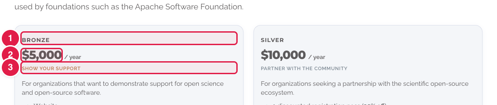
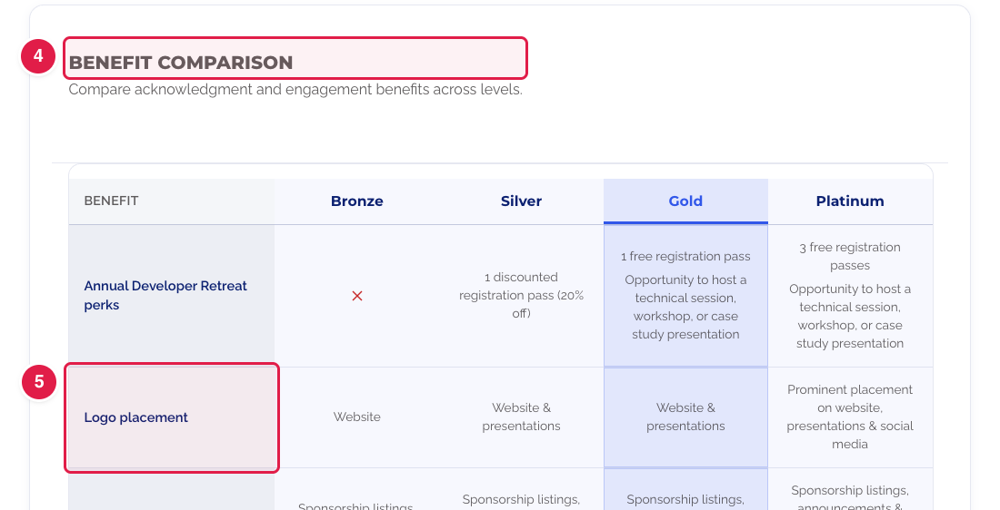
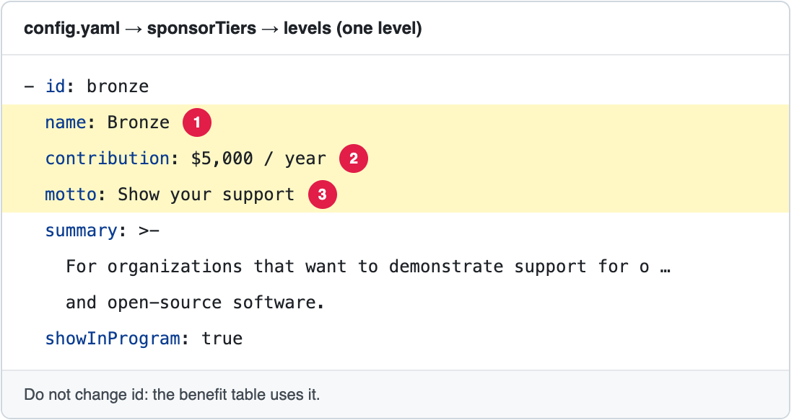
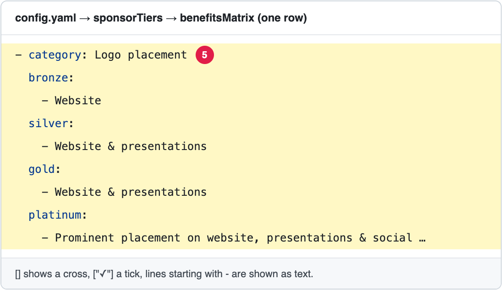

# Change the sponsorship levels and benefits

The page **Our Sponsorship Program** (**https://openms.de/sponsor-us/**) shows four **sponsorship levels** (Bronze, Silver, Gold, Platinum) and a **Benefit comparison** table.

**You will change:** a few lines in `config.yaml`  ·  **Time:** about 15 minutes  ·  **Skills needed:** none

**On the website**





**In `config.yaml`**





The numbers match: the part marked **1** on the website is the line marked **1** in the file.

## What you will change

| Part of the page | Search for | Lines |
|------------------|-----------|-------|
| The small word above the title, and the intro | `sponsorUsPage:` | `eyebrow`, `subtitle` |
| Heading and notes above the levels | `sponsorTiers:` | `eyebrow`, `title`, `intro`, `note` |
| One level (name, price, motto, text) | `levels:` | `name`, `contribution`, `motto`, `summary` |
| The level that is highlighted | `featuredLevel:` | The `id` of a level, for example `gold` |
| The **Benefit comparison** table | `benefitsMatrix:` | One row per `category` (see below) |
| The **FAQ** questions and answers | — | See [Add or change a question in the sponsorship FAQ](update-faq.md). |
| "Why sponsor OpenMS", "How sponsorship works" | — | These are part of the design. Ask the web team ([Who to ask](../../workflow/who-to-ask.md)). |

## Change a level

```yaml
          - id: bronze
            name: Bronze
            contribution: $5,000 / year
            motto: Show your support
            summary: >-
              For organizations that want to demonstrate support for open science
              and open-source software.
```

Change the words after `name:`, `contribution:`, `motto:` or `summary:`. **Do not change `id:`**: the benefit table uses it.

## Change the benefit table

Each row of the table is one `category`, with one entry per level:

```yaml
          - category: Logo placement
            bronze:
              - Website
            silver:
              - Website & presentations
            gold: ["✓"]
            platinum: []
```

| You write | The table shows |
|-----------|-----------------|
| `[]` | a cross: not included |
| `["✓"]` | a tick: included |
| lines starting with `- ` | each line as text |

To **add a row**, copy a whole `- category:` block and change it. To **remove a row**, delete its whole block. Every row needs one line per level, even if it is only `[]`: a missing line makes the build fail. **If you add a level**, add its line to every row.

The full guide for the benefits, with pictures: [Change the benefits of the sponsorship levels](update-benefits.md).

## Step by step

1. Open **https://github.com/OpenMS/OpenMS-website/blob/main/config.yaml** and click the **pencil icon**. ([Need help?](../../getting-started/edit-via-github.md#step-1--open-the-file))
2. Click inside the text box, press **Ctrl + F** (Windows) or **Cmd + F** (Mac) and search for the word from the tables above.
3. Change **only the words after the colon**. Keep the quotes and the spaces at the start of each line. See [Spaces matter](../../getting-started/edit-via-github.md#spaces-matter-in-configyaml).
4. Save and send for review: [How to make a change, steps 3 to 6](../../getting-started/edit-via-github.md#step-3--save-commit-changes).
5. Open the **Deploy Preview** and check **/sponsor-us/**. Click each level to see its benefits.

## Related guides

- [Add or change a question in the sponsorship FAQ](update-faq.md)
- [Change the benefits of the sponsorship levels](update-benefits.md)
- [Add, change or remove a sponsor logo](../our-sponsors/update-sponsors.md)
- Back to the [list of all tasks](../README.md)
