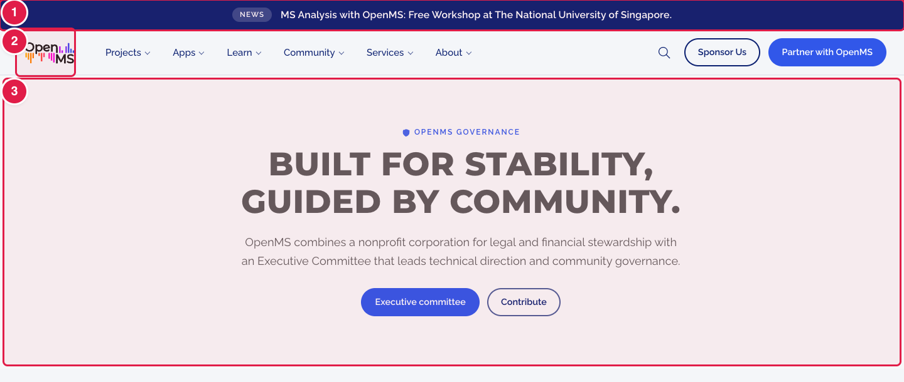
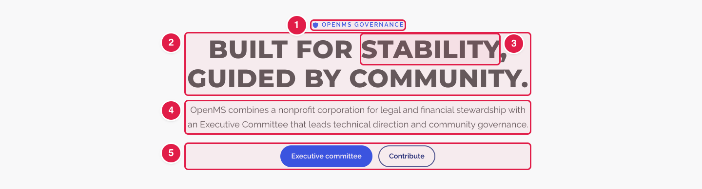
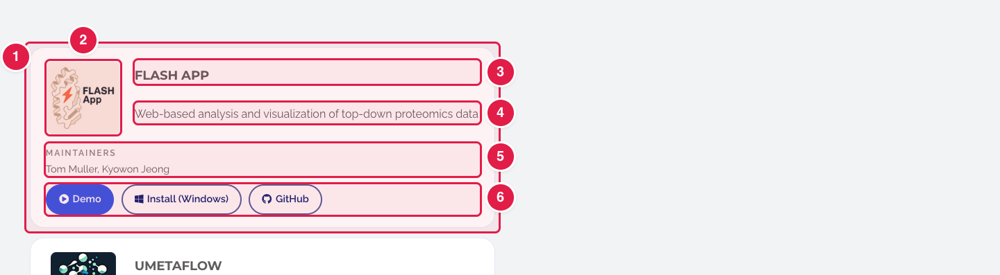

# Words we use (hero, eyebrow, banner…)

The guides and `config.yaml` use a few words for the parts of a page. Here is what they mean, with pictures.

## The parts of every page

| Number | Word | What it is | Where it is written |
|:--:|------|-----------|---------------------|
| 1 | **Announcement bar** (also **news banner**) | The dark strip at the very top of every page, with one short message. | `config.yaml` → `newsBanner`. Guide: [Change the announcement bar](../common-tasks/navbar/update-announcement-bar.md) |
| 2 | **Navbar** (the **top menu**) | The logo and the menu (Projects, Apps, Learn…) under the announcement bar. A menu that opens is a **drop-down list**; its lines are `sublinks`. | `config.yaml` → `navbar`. Guide: [Change the top menu](../common-tasks/navbar/edit-menu-items.md) |
| 3 | **Hero** | The big first block at the top of a page: small label, big title, a short text and buttons. On the home page it is also called the **top banner**. | Home page: `config.yaml` → `hero`. Other pages: see the guide for that page. |
| – | **Footer** | The dark block at the bottom of every page, with links in four columns and the social icons. | `config.yaml` → `footer`. Guide: [Change the footer links](../common-tasks/footer/edit-footer-links.md) |

## The parts of a hero (and of most blocks)

| Number | Word | What it is | Usual name in `config.yaml` |
|:--:|------|-----------|-----------------------------|
| 1 | **Eyebrow** | The small label in capital letters above a title. | `eyebrow` |
| 2 | **Title** (or **headline**) | The big words. | `title`, `headline`, `titleBefore` / `titleAfter` (home page) |
| 3 | **Highlight** | The word(s) of the title shown in another colour. They must also appear in the title. | `titleHighlight` |
| 4 | **Intro** (or **subtitle**, **lead**, **description**, **blurb**) | The short paragraph under the title. These five names all mean the same kind of text. | `subtitle`, `lead`, `description`, `blurb` |
| 5 | **Buttons** (also **CTA**, "call to action") | The buttons people click. Each has words and an address. | `buttontext` / `buttonlink`, `ctaText` / `ctaUrl` |

Most blocks on the website follow the same pattern: an eyebrow, a title (sometimes with a highlight), an intro, then cards or buttons.

## The parts of a card

| Number | Word | What it is | Usual name in `config.yaml` |
|:--:|------|-----------|-----------------------------|
| 1 | **Card** | One box inside a block: one app, one sponsor, one event… A list of cards is a list of blocks in `config.yaml`, each starting with `-`. | for example `webapps`, `affiliateProjects`, `items` |
| 2 | **Logo** | The picture of the card. It must first be uploaded to `static/images/` (see [Add images](../common-tasks/any-page/add-images.md)). | `logo` |
| 3 | **Name** | The title of the card. | `name`, `title` |
| 4 | **Description** | The short text of the card. | `description`, `text` |
| 5 | **Maintainers** | The people who look after the app. | `maintainers` |
| 6 | **Links** (the buttons of a card) | Each `- type:` line under `links:` is one button. How many fit: see [Featured Apps](../common-tasks/featured-apps/update-featured-apps.md#how-many-buttons-links-can-an-app-have) and [Affiliated Apps](../common-tasks/affiliated-apps/update-affiliated-apps.md#how-many-buttons-links-can-a-project-have). | `links` |

## Other words on the website

| Word | What it is | Usual name in `config.yaml` |
|------|-----------|-----------------------------|
| **Block** (or **section**) | One part of a page, from one side of the screen to the other. The home page is a stack of blocks. | each block has its own name, for example `keyfeatures` |
| **Tag** (or **badge**, **chip**) | A small label inside a card or under a title, like "C++ library" or "Fully remote & unpaid". | `tag`, `chips` |
| **Logo strip** | The two rows of logos that move sideways on the home page ("Adopted by labs and institutions worldwide"). | `universityPartners` |
| **Icon** | A small symbol, like the GitHub cat or a calendar. Leave these lines as they are unless the guide says otherwise. | `icon` |
| **Address** (or **link**, **URL**) | Where a button or link goes. A page of this website starts with `/` (for example `/contribute/`). Another website starts with `https://`. | `url`, `link` |
| **External link** | A link to another website. It opens with a small arrow. | `is_external: true` |

## Words about the files

| Word | What it is |
|------|-----------|
| **`config.yaml`** | The big settings file. Most words of the website are in it. |
| **Key** | The word **before** the colon on a line of `config.yaml`, for example `title`. Never change it. |
| **Value** | The words **after** the colon. This is what you change. |
| **Page file** | A text file in `content/en/` that holds one page, for example `content/en/impressum.md`. It is written in **Markdown**. |
| **Front matter** | The top of a page file, between the two `---` lines. These are settings for the page. Change only `title:`. |
| **Layout** (or **design file**, **partial**) | A file in `layouts/` that decides how a page looks. Ask the web team to change these. |
| **Shortcode** | A line like `` in a page file. It is a building block: leave it as it is. |

## Words about making a change

| Word | What it is |
|------|-----------|
| **Commit** | Saving your change on GitHub. |
| **Branch** | Your own copy of the website files where your change waits. |
| **Pull request** (PR) | Your request to add the change to the real website. Someone from the web team checks it. See [Pull requests](../workflow/pull-requests.md). |
| **Deploy Preview** | A test copy of the website with your change, made automatically for each pull request. Check your change there before it goes live. |

Back to the [list of all tasks](../common-tasks/README.md) · [How to make a change](edit-via-github.md)
